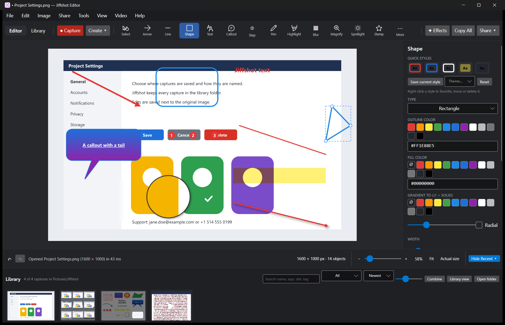
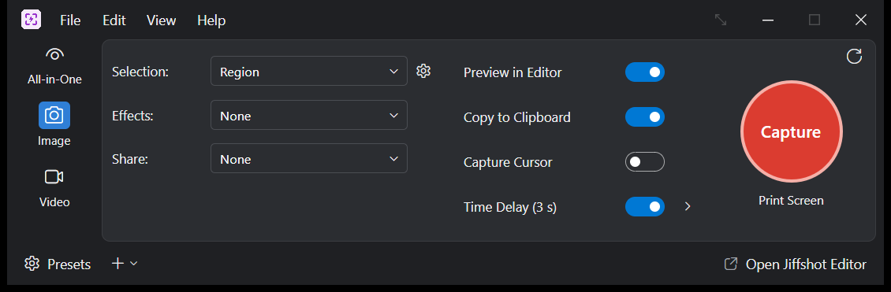
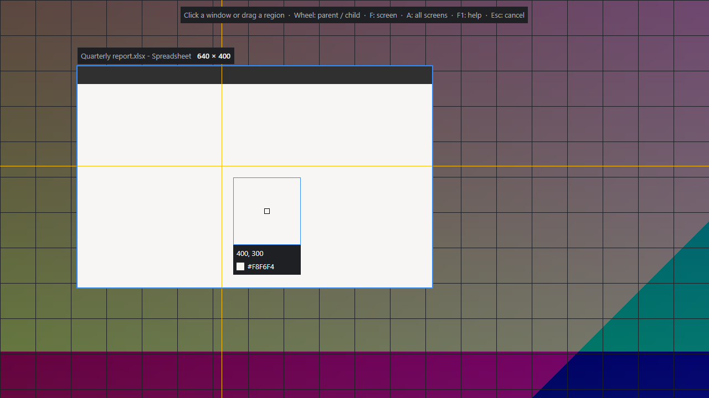
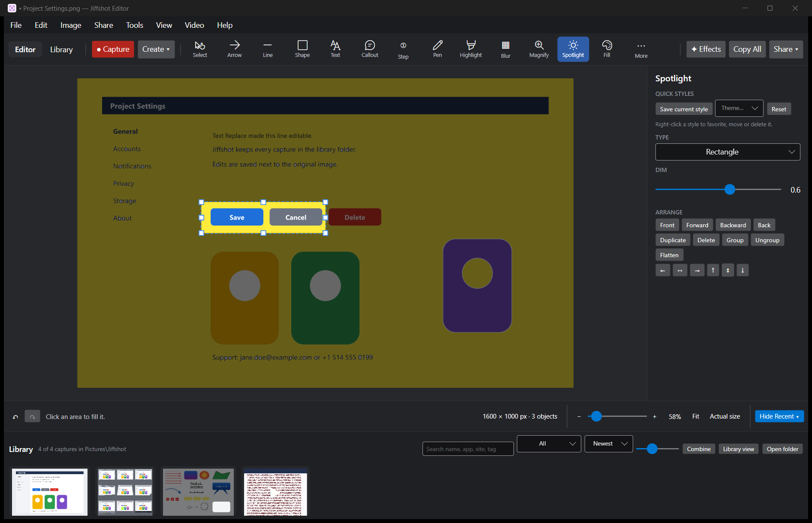
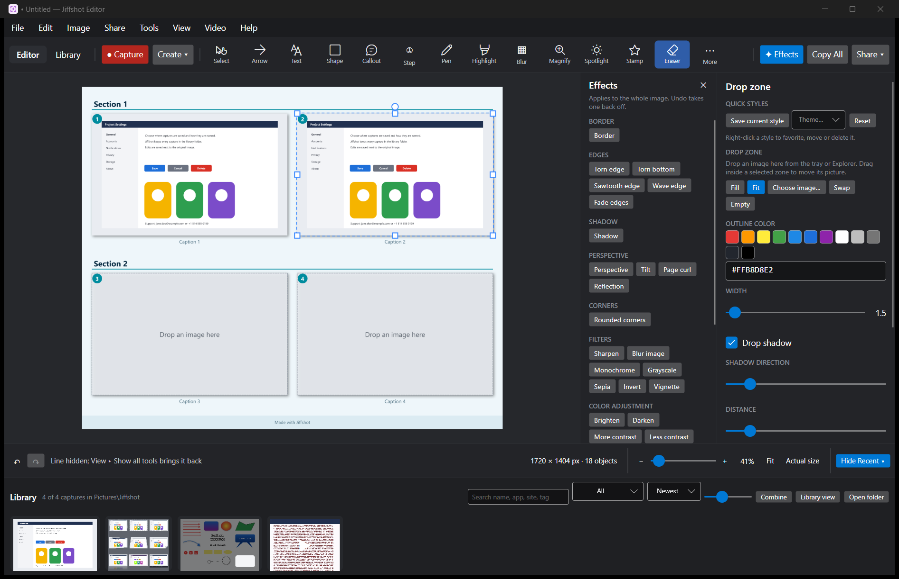
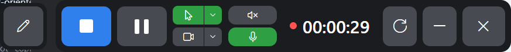
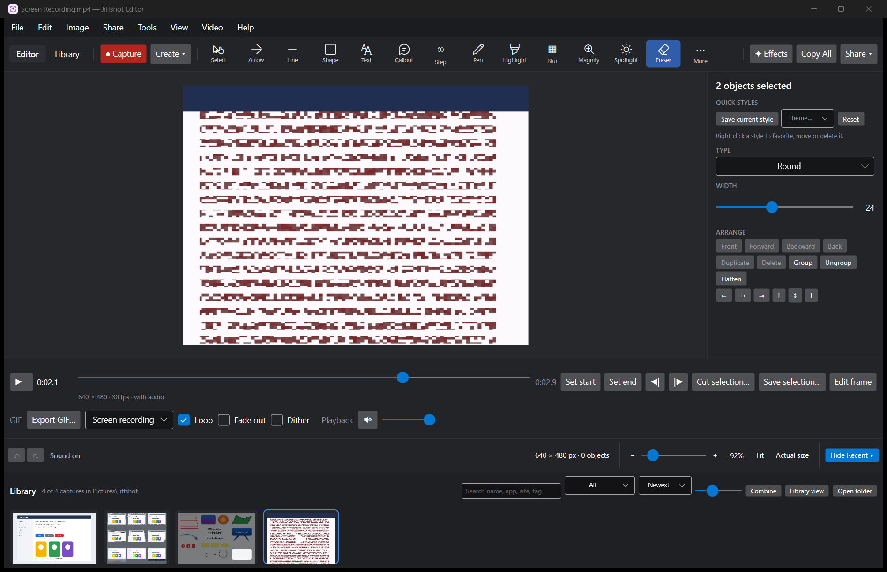
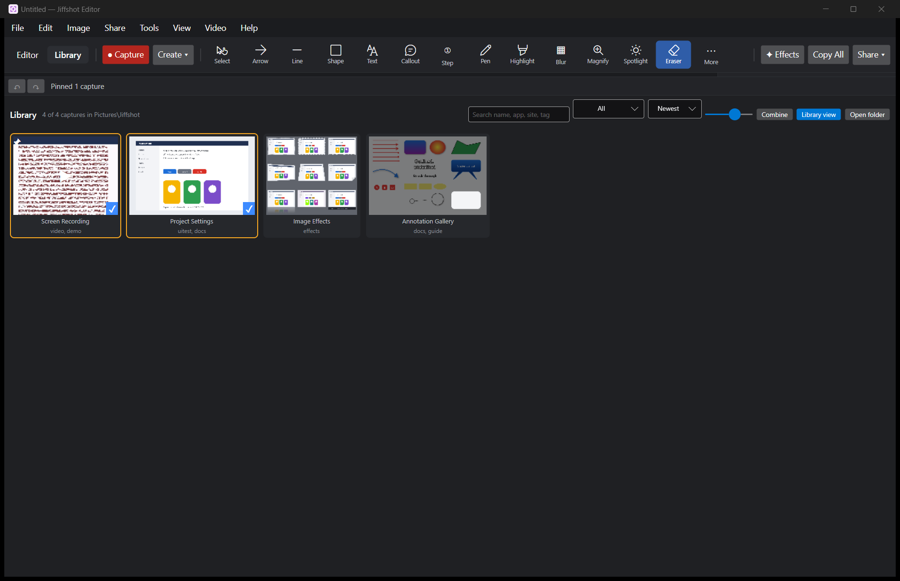
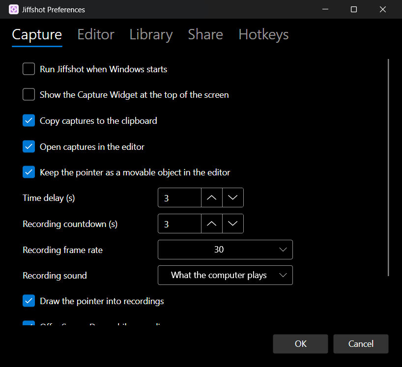

<p align="center">
  
</p>

<h1 align="center">Jiffshot</h1>

<p align="center">
  <strong>Fast screen capture, recording, and image &amp; video editing for Windows, macOS, and Linux.</strong>
</p>

<p align="center">
  <a href="https://github.com/Devolutions/jiffshot/releases/latest"><strong>Download Latest Release</strong></a>
  ·
  <a href="https://github.com/Devolutions/jiffshot/releases">All Releases</a>
  ·
  <a href="#features">Features</a>
  ·
  <a href="#keyboard-shortcuts">Shortcuts</a>
  ·
  <a href="#command-line-usage">CLI</a>
  ·
  <a href="#building-from-source">Build from Source</a>
</p>

---

**Jiffshot** is a native screen capture tool, screen recorder, and non-destructive image and video editor for Windows 10/11 and Linux. The Linux build supports opening, annotating, and exporting images and `.jsd` documents, portal-based monitor/window and desktop-selected screenshots, screen text capture, delayed, interval and daily scheduled captures, manual scrolling and panoramic capture, MP4 screen recording with pause/resume, restart/cancel and optional system sound, microphone audio and webcam overlay, video trim/middle-cut/combining/frame import/GIF and silent MP4 export, Tesseract-backed OCR, and opt-in tray operation and portal-based shortcuts. The full Windows video editor, additional global hotkeys, and some desktop integrations remain unavailable on Linux.

An experimental macOS port targets macOS 13 or later on Apple Silicon and Intel. Feature parity is still being verified; in particular, mixed-scale displays, advanced capture, media, sharing, and application shutdown are not yet fully validated. See [macOS builds](#macos-builds) for source builds and permissions.

<p align="center">
  
</p>

## Download & Installation

Prebuilt, Authenticode-signed packages for **Windows 10 and Windows 11** (`x64` and `ARM64`) are available on the [**GitHub Releases**](https://github.com/Devolutions/jiffshot/releases) page:

👉 **[Download Jiffshot from GitHub Releases](https://github.com/Devolutions/jiffshot/releases/latest)**

| Package | Architecture | Description |
|---|---|---|
| **`Devolutions.Jiffshot-x64-<version>.msi`** | Windows x64 (Intel / AMD) | Standard Windows Installer. Installs to `C:\Program Files\Devolutions\Jiffshot`, adds a Start Menu shortcut, and associates `.jsd` Jiffshot Document files. |
| **`Devolutions.Jiffshot-arm64-<version>.msi`** | Windows ARM64 | Standard Windows Installer for Windows on ARM devices. |
| **`Devolutions.Jiffshot-x64-<version>.msix`** | Windows x64 (Intel / AMD) | Signed MSIX package. Install it to add Jiffshot to Windows; uninstall it from Installed apps. |
| **`Devolutions.Jiffshot-arm64-<version>.msix`** | Windows ARM64 | Signed MSIX package for Windows on ARM devices. |
| **`Devolutions.Jiffshot-x64-<version>.zip`** | Windows x64 (Intel / AMD) | Portable archive—unzip anywhere and run `jiffshot.exe`. Nothing is installed in the system. |
| **`Devolutions.Jiffshot-arm64-<version>.zip`** | Windows ARM64 | Portable archive for Windows on ARM devices. |

Linux x64 and ARM64 release builds are configured to produce a portable `.tar.gz`
and Ubuntu 24.04 `.deb`, plus a separately built native Fedora 43 `.rpm` for each
architecture. See
[Building and Installing Linux Packages](#building-and-installing-linux-packages)
for their dependencies and current limitations. The Linux GUI requires X11 or
XWayland; a Wayland-only session without XWayland is not supported by the
current Rustolonia host.

> **Note for Windows "N" editions:** Video recording uses Windows Media Foundation, which is omitted from Windows "N" SKUs by default. Install Microsoft's *Media Feature Pack* in Windows Optional Features to enable MP4 recording and playback.

## Quick Start (Windows)

### Linux

1. **Launch Jiffshot:** Open Jiffshot from the application menu or run `jiffshot`.
2. **Take a capture:** Choose **Capture screen or window…** or **Desktop screenshot chooser…**, then select a source in the desktop portal. A working XDG portal and PipeWire session are required.
3. **Annotate & export:** Captures open in the editor, are saved under `Pictures/Jiffshot` by default, and are copied to the clipboard when available. Use **Export…** for a flattened image or save an editable `.jsd` document.
4. **Record or use shortcuts:** Start and stop recording with **Record screen… (start/stop)**. Optionally enable a global capture shortcut through the desktop portal. Closing the window exits unless tray operation is enabled and a tray host is available.

### Windows

1. **Launch Jiffshot:** Start **Devolutions Jiffshot** from the Start Menu (or run `jiffshot.exe` from the portable folder). Jiffshot places its icon in the Windows notification area (system tray).
2. **Take a capture:** Press **Print Screen** (`PrtScn`) at any time, or left-click the tray icon to open the **Capture Window** and choose a capture mode.
   - **Capture a window or UI element:** Move the pointer over any window and click. Roll the **mouse wheel** up or down while hovering to step between the top-level window and individual child UI controls.
   - **Capture a region:** Click and drag a rectangle. Hold `Shift` for a square, `Ctrl` for `16:9`, or `Ctrl+Shift` for `4:3`.
   - **Capture a full monitor or desktop:** Press `F` for the current screen or `A` for all screens.
3. **Annotate & share:** By default, captures are saved to `Pictures\Jiffshot`, copied to the clipboard, and opened in the **Jiffshot Editor** where you can add arrows, callouts, numbered steps, blur, or effects, then copy (`Ctrl+Shift+C`), export (`Ctrl+E`), or share directly to other apps.
4. **Stay ready in the tray:** Closing the editor window keeps Jiffshot running quietly in the notification area so your hotkeys stay active. To quit completely, right-click the tray icon and choose **Exit**.

---

## Features

The detailed feature list below describes the Windows application. The Linux build currently supports the subset described in [Building from Source](#building-from-source).

### Flexible Screen Capture

<p align="center">
  
</p>

- **All-in-One, Image & Video Tabs:** Use the dedicated Capture Window (or the compact top-of-screen **Capture Widget**) to configure selection modes, automatic effects, share destinations, cursor capture, and timers before starting.
- **Smart Selection Overlay:** Captures from an instant frozen desktop snapshot so transient UI states never move while you aim. Includes a live pixel magnifier with coordinates and `#RRGGBB` color readout, dimension labels, and on-screen help (`F1`).
- **Specialized Capture Modes:**
  - **Scrolling Capture:** Automatically scrolls and stitches vertical, horizontal, or two-axis scrolling windows and web pages.
  - **Panoramic Capture:** Pan across a scrollable area at your own pace and stitch it live.
  - **Freehand, Multi-Area & Fixed Size:** Lasso an arbitrary shape (transparent outside), select multiple distinct rectangles in one shot, or stamp a fixed-pixel rectangle.
  - **Open Menus:** Delayed capture mode designed to grab open context menus and dropdowns.
  - **Grab Text (Windows OCR):** Select any area on screen to extract selectable, copyable text instantly.
  - **Step Capture:** Record a numbered click-by-click guide automatically—every click captures a screenshot and places a sequential step badge at the cursor.
- **Timers, Schedules & Presets:** Delay captures by seconds, run an automatic **time-lapse** (skipping identical frames), schedule a daily capture at a set time (`HH:MM`), or save custom **Presets** with their own global hotkeys.
- **Post-Capture Sharing:** Send captures automatically to the clipboard, the editor, a file, email, Microsoft Word, PowerPoint, Excel, OneNote, Paint, any configured external program, an FTP server (using Windows Credential Manager), or a printer.

<p align="center">
  
</p>

### Non-Destructive Image Editor & Annotations

- **Vector Annotation Tools:**
  - **Arrows & Lines:** Straight or curved paths with customizable arrowheads/caps, dashed/dotted strokes, drop shadows, and opacity.
  - **Shapes & Callouts:** Rectangles, rounded boxes, ellipses, and multi-point polygons; speech/thought callouts with one or multiple draggable tails and gradient fills.
  - **Text & Step Badges:** Rich text boxes with outlines, fills, alignment, and formatting; auto-incrementing numbered, lettered, or Roman-numeral step markers.
  - **Pen, Highlighter & Stamps:** Freehand drawing, multiply-blend highlighters, built-in icon stamps, flood fill, eraser, magic wand background removal, and eyedropper.
  - **Blur, Magnify & Spotlight:** Pixelate, Gaussian-blur, or solid-redact sensitive regions; add circular/rectangular zoom loupes; dim or blur the background outside one or more spotlight areas.
- **Movable Cursor Object:** Optionally captures the mouse pointer as a separate layer you can move, resize, or delete in the editor. If that layer cannot be saved, the image remains in the library and Jiffshot reports the problem instead of opening an incomplete edit automatically.
- **Quick Styles & Themes:** Save custom tool styles, switch Quick Style palettes, customize the toolbar order, and switch between **Dark**, **Light**, and **System** themes across every Jiffshot window.

### Smart Editing Tools

<p align="center">
  
</p>

- **Text Replace:** Drag over existing text in a bitmap screenshot to recognize it via OCR, cleanly fill the background behind it, and replace it with an editable text object in place.
- **Smart Move:** Drag around a button, card, or UI element to lift it off its background (automatically filling the hole left behind) so you can reposition it anywhere.
- **Smart Redact:** Scan the screenshot with one click to automatically detect and cover sensitive patterns such as email addresses and phone numbers with removable redaction boxes.
- **Simplify UI:** Convert dense UI text across a screenshot into clean, color-matched placeholder bars for simplified documentation graphics.
- **Cut Out & Auto-Trim:** Drag horizontally or vertically across a section to slice it out and join the remaining halves (with a straight seam or torn edge), or auto-trim solid-colored margins in one click.

### Effects, Templates & Image Combining

<p align="center">
  
</p>

- **Whole-Image Effects:** Apply Borders, Torn / Wave / Sawtooth / Faded edges, Drop Shadows, 3D Perspective & Tilt, Page Curl, Reflection, Rounded Corners, Sharpen, Blur, Monochrome, Grayscale, Sepia, Invert, Vignette, Brightness/Contrast, Hue Shift, and Capture Info watermarks.
- **Multi-Section Templates:** Build side-by-side comparisons and multi-step guides with drop zones, automatic section numbers, captions, themes (Light, Dark, Ocean, Warm), and custom footers. Drag images directly from the Recent Captures tray or File Explorer into any drop zone.
- **Combine Images:** Stitch multiple captures horizontally or vertically with configurable spacing and background fill.

### Screen Recording & Built-In Video / GIF Editor

<p align="center">
  
</p>

- **Area, Window & Fullscreen Recording:** Record MP4 video at 15, 24, 30, or 60 FPS. Press `G` while selecting to snap to standard `1920×1080`, `1280×720`, `640×480`, or `320×240` guides.
- **System Audio, Microphone & Webcam:** Record system audio ("what the computer plays"), your microphone (with an optional between-words noise gate), or both mixed together. Add a live circular or rectangular **webcam picture-in-picture** overlay in any corner.
- **Pointer Effects & Live Screen Draw:** Highlight the cursor with a halo, show animated click rings, and draw live arrows, boxes, highlights, and freehand marks directly over the screen while recording (with configurable auto-fade).
- **Live Recording Toolbar:** Pause, resume, restart, minimize, or cancel the recording, and toggle cursor effects, webcam, microphone, system sound, and Screen Draw on the fly—all from a floating toolbar that stays invisible to the recording itself.
- **Video Editing & Animated GIF Export:** Trim the start and end, cut out unwanted middle sections, step frame-by-frame, extract any frame as a still image, save a silent copy, combine videos, record narrated slideshows from still images, or export optimized **Animated GIFs** with presets (*Screen recording*, *High motion*, *Small file*), looping, cross-fade, and dithering.

<p align="center">
  
</p>

### Capture Library & Unified Preferences

<p align="center">
  
</p>

- **Searchable Capture Library:** Every capture is stored in `Pictures\Jiffshot` (grouped into `YYYY-MM` folders) alongside a metadata sidecar recording the window title, application process, browser URL, dimensions, timestamp, tags, and pin status.
- **Instant Filtering & Organization:** Filter by *Images*, *Videos*, *Pinned*, *Today*, *Last 7 days*, *Tagged*, specific applications (`App: ...`), websites (`Site: ...`), or tags (`Tag: ...`). Pin important items to the front, tag or rename captures in place, and select multiple items to combine them into a single image or slideshow. Renaming moves companions along with the capture and refuses to replace existing files; if a partial rename cannot be rolled back, the error identifies the files needing recovery.
- **Copy & Drag Out:** Right-click any capture in the Library or the Recent Captures tray and choose **Copy** to put the image (with its edits) on the clipboard; videos and multiple picked captures are copied as files. Drag captures from the tray or Library straight into other applications such as Explorer, Outlook, Teams, or a browser. On macOS, see the platform notes below.
- **Editable `.jsd` Documents & Multi-Format Export:** Edits to library captures are saved automatically as non-destructive `.jsd` companion files, so annotations stay movable and editable whenever you reopen a capture. Export flat files to **PNG**, **JPEG**, **PDF**, **BMP**, **GIF**, and **WebP**.
- **One Preferences Dialog:** Configure Capture behavior, Editor layout and theme, Library location, Share destinations, and global Hotkeys from a single window (`Ctrl+,`).

<p align="center">
  
</p>

---

## Keyboard Shortcuts

### Global Hotkeys

| Windows | macOS | Action |
|---|---|---|
| `Print Screen` (`PrtScn`) | `Cmd+Shift+2` | Start an interactive capture; falls back to another shortcut if the configured key is unavailable |
| `Ctrl+Print Screen` | `Cmd+Shift+1` | Capture the full screen immediately |
| `Shift+Print Screen` | `Cmd+Shift+7` | Repeat the last region capture |
| Custom | Custom | Run a saved Capture Preset (**Preferences ▸ Hotkeys**) |

On macOS, Jiffshot leaves Apple's `Cmd+Shift+3`, `Cmd+Shift+4`, and `Cmd+Shift+5` shortcuts available.

### Selection Overlay Controls

| Input / Key | Action |
|---|---|
| **Left Click** | Capture the highlighted window or UI element under the cursor |
| **Mouse Wheel** | Walk up and down between parent windows and child UI elements |
| **Click + Drag** | Select a custom rectangular region |
| `Shift` / `Ctrl` / `Ctrl+Shift` (while dragging; use `Cmd` instead of `Ctrl` on macOS) | Lock aspect ratio to **1:1 square**, **16:9**, or **4:3** |
| **Arrow Keys** (`Shift+Arrows`) | Nudge the pointer by `1 px` (`10 px` with `Shift`) for pixel-exact edges |
| `Shift+Enter` | Start or finish a rectangular selection at the pointer using the keyboard |
| `Enter` / `Space` | Confirm the current selection |
| `F` | Capture the monitor under the cursor |
| `A` | Capture the entire multi-monitor desktop |
| `M` | Show or hide the pixel magnifier |
| `G` | Show or hide standard video resolution guides (`1080p`, `720p`, `480p`, `240p`) |
| `Backspace` | Remove the last rectangle (in Multi-Area capture mode) |
| `F1` | Show or hide the on-screen keyboard help |
| `Esc` | Cancel capture |

### Recording & Screen Draw Shortcuts

| Shortcut | Action |
|---|---|
| `Shift+F9` | Pause or resume recording |
| `Shift+F10` | Stop and save recording |
| `Shift+F8` | Toggle live **Screen Draw** mode while recording |
| `P` / `A` / `L` / `S` / `E` / `H` (in Screen Draw) | Select **Pen**, **Arrow**, **Line**, **Rectangle**, **Ellipse**, or **Highlighter** |
| `1` … `6` (in Screen Draw) | Choose drawing color |
| `Ctrl+Z` / `C` (in Screen Draw) | Undo last mark / clear all Screen Draw marks |
| `Esc` | Exit Screen Draw, or cancel the recording |

### Editor Shortcuts

On macOS, use `Cmd` in place of `Ctrl` in the following editor shortcuts.

| Shortcut | Action |
|---|---|
| `Ctrl+Shift+N` | New screen capture |
| `Ctrl+N` / `Ctrl+Shift+V` | New blank image / New image from clipboard |
| `Ctrl+O` | Open file (`.png`, `.jpg`, `.bmp`, `.gif`, `.webp`, `.mp4`, `.jsd`) |
| `Ctrl+S` / `Ctrl+Shift+S` | Save / Save as (`.jsd` document) |
| `Ctrl+E` | Export flattened image (`PNG`, `JPEG`, `PDF`, `BMP`, `GIF`, `WebP`) |
| `Ctrl+Shift+C` | Copy flattened image to clipboard |
| `Ctrl+P` / `Ctrl+W` | Print / Close current capture |
| `Ctrl+Z` / `Ctrl+Y` | Undo / Redo |
| `Ctrl+C` / `Ctrl+X` / `Ctrl+V` | Copy / Cut / Paste selected annotation objects |
| `Ctrl+A` / `Ctrl+D` / `Ctrl+Shift+I` | Select all / Deselect / Invert selection |
| `Ctrl+Shift+G` / `Ctrl+Shift+U` | Group / Ungroup selected objects |
| `Ctrl+Shift+F` / `Ctrl+Shift+B` | Bring forward / Send backward |
| `Ctrl+T` / `Ctrl+Shift+T` | Flatten selected objects / Flatten all objects into background |
| `Ctrl+1` … `Ctrl+9` | Switch between the first nine toolbar tools |
| `Ctrl++` / `Ctrl+-` / `Ctrl+0` / `Ctrl+Alt+0` | Zoom in / Zoom out / Actual size (`100%`) / Fit to window |
| `Ctrl+G` | Toggle pixel grid (when zoomed in) |
| `Ctrl+L` | Toggle full Library view |
| `Ctrl+,` | Open Preferences |
| `F1` | Show Keyboard Shortcuts dialog |

---

## Command-Line Usage

`jiffshot.exe` supports command-line arguments for launching specific capture modes, opening files, or scripting captures from a terminal. If Jiffshot is already running in the tray, launching `jiffshot.exe` a second time forwards the command to the running instance.

```powershell
# Start Jiffshot in the system tray (or open the Capture Window if already running)
jiffshot.exe

# Open one or more image, video, or .jsd files in the editor
jiffshot.exe screenshot.png recording.mp4

# Trigger an interactive capture mode immediately
jiffshot.exe --capture        # Region, window, or screen capture
jiffshot.exe --scrolling      # Scrolling window/page capture
jiffshot.exe --panoramic      # Panoramic capture
jiffshot.exe --text           # Grab Text (OCR) capture
jiffshot.exe --record         # Video screen recording
jiffshot.exe --menu           # Delayed capture for open menus
jiffshot.exe --steps          # Step Capture (numbered click guide)
jiffshot.exe --freehand       # Freehand lasso capture
jiffshot.exe --window         # Open the Capture Window

# Scripted / headless utilities
jiffshot.exe --grab 0,0,1920,1080 out.png   # Capture a screen rectangle (X,Y,W,H) to PNG
jiffshot.exe --grab screen out.png          # Capture the monitor under the cursor to PNG
jiffshot.exe --ocr image.png                # Print recognized OCR text lines to stdout
jiffshot.exe --monitors                     # List connected monitors, bounds, and DPI scale
jiffshot.exe --list-windows                 # List detected window and child-element capture targets
jiffshot.exe --quit                         # Stop the running Jiffshot instance
```

### Automation and AI agents: `jiffshot-cli` (Windows)

`jiffshot-cli.exe`, installed beside `jiffshot.exe`, drives the running Jiffshot (starting it if needed) so a script or an AI agent can screenshot, record and annotate a desktop software demo without anyone clicking through it by hand. Every command prints one JSON object and returns a meaningful exit code. It can click, type, press keys, find text by OCR and controls by UI Automation, and wait for windows or text.

The CLI also supports bounded scrolling captures, live recording annotations,
webcam/audio controls, headless editable image documents (all annotation tools,
undo/redo, transforms, effects and templates), and video trimming/joining,
timed overlays and MP4/GIF exports. Scripted sequences can reuse typed results
between steps and always execute cleanup. See the
[capability coverage and boundaries](docs/cli.md#capability-review-and-boundaries)
for what is supported and what still needs an external tool.

```powershell
jiffshot-cli windows --process notepad
jiffshot-cli record start --window 0x86070A --out C:\demo\demo.mp4 --clicks
jiffshot-cli type "Hello from an agent\n" --window 0x86070A
jiffshot-cli click --window 0x86070A --element File
jiffshot-cli record stop                       # waits for the finished MP4
jiffshot-cli run demo.json                     # a whole scripted sequence
jiffshot-cli help agent                        # the guide for AI agents
```

See [docs/cli.md](docs/cli.md) for every command, the JSON output and scripted sequences.

## Where Captures & Settings Are Stored

- **Captures Library:** `Pictures\Jiffshot` on Windows, or `~/Pictures/Jiffshot` on macOS. It is configurable in **Preferences ▸ Library** or through `JIFFSHOT_LIBRARY`.
- **Settings File:** `%APPDATA%\Jiffshot\jiffshot.json` on Windows, or `~/Library/Application Support/Jiffshot/jiffshot.json` on macOS.
- **Thumbnail Cache & Logs:** `%LOCALAPPDATA%\Jiffshot` on Windows, or `~/Library/Caches/Jiffshot` on macOS.

---

## Building from Source

Jiffshot is written in Rust with its UI built on [Rustolonia](https://github.com/Devolutions/rustolonia)'s code-first API (Avalonia, with no AXAML or C# in the application). See [docs/architecture.md](docs/architecture.md) for an overview of how the crates and threads fit together.

### Repository Layout

| Path | Contents |
|---|---|
| `crates/jiffshot-capture/` | Monitors and DPI, screen grabs, window targets, clipboard, OCR, media (recording and playback), the library, settings |
| `crates/jiffshot-doc/` | Documents: annotation objects, rendering, editing and undo, effects, smart tools, `.jsd` and image files |
| `crates/jiffshot-workflow/` | The capture side: tray, hotkeys, selection overlay, recording, capture panels, post-capture workflow, command-line modes, the control server for `jiffshot-cli` |
| `crates/jiffshot-control/` | The local control protocol: JSON requests over a per-user named pipe |
| `crates/jiffshot-cli/` | Windows `jiffshot-cli.exe`: the command-line client for scripts and AI agents |
| `app/` | Windows and Linux application entry points, editors, platform integrations, and UI |
| `package/` | Windows MSI/MSIX packaging and Linux tar.gz, DEB, and RPM package builders |

Platform implementations are isolated in `app/src/win/` and `app/src/linux/`,
with suffix-free module names and a thin `app/src/main.rs` dispatcher. The canvas,
document engine, tracing, and library-tag helpers stay shared; the shared canvas
view remains under `app/src/ui/`. Windows capture backends live in
`crates/jiffshot-capture/src/win/`, while the crate root retains its existing
public API and shared frame, geometry, and stitching primitives. The Windows
workflow engine remains in `jiffshot-workflow`; Linux workflows live under
`app/src/linux/`.

### Compiling

On Windows and Linux, Jiffshot requires **Rust 1.88+** and uses Rustolonia's `v12.1.2` release: the first build downloads the platform's prebuilt host, verified against the checksums pinned at the tag. No .NET SDK or Rustolonia checkout is required for that build. The experimental macOS port currently needs a different compatible host as described below.

```powershell
cargo run --release -p jiffshot
```

The build copies the host next to `jiffshot.exe`, so `target/release` runs as it is; zip `jiffshot.exe` and the host DLLs beside it, with `app/README-portable.txt`, for the portable app.

On Linux (including WSLg), build and run the image/document editor with:

```sh
cargo run --release -p jiffshot
```

The installed `jiffshot` command accepts a single image, video or `.jsd` path.
Use `jiffshot --capture`, `--capture-interactive`, `--grab-text`, `--scrolling`,
`--scrolling-horizontal`, `--panoramic`, `--interval`, or `--record` to start a capture action
directly; scrolling and panning are manual, `--interval` uses saved interval preferences,
and `--record` starts without audio. The installed desktop
entry also offers capture, screen text, scrolling, panoramic, interval and recording actions where the desktop
supports application actions. Use `--help` for the complete Linux command-line
usage. The separate `jiffshot-cli` automation client is available on Windows and macOS.

File and folder choosers use the XDG FileChooser portal when available and
fall back to the native GTK picker when it is unavailable. Other portal errors
are reported; canceling a chooser does not change the document.

The Linux editor exposes the document engine's annotation and selection tools, undo/redo, zoom, pixel grid, tool-variant cycling, and horizontal, vertical, or grid image combining. Enable **Templates** to create an editable layout with a theme, optional captions, numbers and footer. Select a zone and choose **Paste into zone** to add an image from the clipboard; use the zone controls to fit, crop, clear or swap images (Shift-click selects two zones). Drag-and-drop into template zones is not currently supported on Linux. Enable **Editor properties and effects** to edit the selected text, callout, or step label and adjust annotation colors, stroke width, font, opacity, and emphasis. Style changes also set the current tool's defaults when nothing is selected. This panel also offers **Auto trim**, **Copy recognized text**, **Smart redact**, and **Simplify UI**. Simplify flattens annotations and replaces recognized text with editable bars, and can be undone. Smart redact covers whole recognized lines containing sensitive patterns, but OCR can miss text: review the result before sharing. Redactions in `.jsd` remain removable and do not erase the underlying image; export a flattened image when the underlying content must not be included. Whole-image effects are undoable. For effects with a numeric setting, enter a value in **Effect parameter** using the indicated units and range; leave it blank for the default. Changing the selected effect clears the value. Border and color replacement use the current stroke and fill colors. **Watermark** selects an image and places it in the bottom-right corner at 35% opacity by default; **Capture info** adds available sidecar capture time, window and process metadata, or the current local time when none is available. **Spotlight & magnify** uses the selected annotation's area, or the image center when nothing is selected. It replaces the selected annotation with the effect; Undo restores it. Linux OCR and Text Replace use the system Tesseract engine; install its development libraries and English language data to enable OCR:

```sh
sudo apt-get install clang libclang-dev libleptonica-dev libtesseract-dev tesseract-ocr-eng
```

The **Editor properties and effects** panel also provides controls to select all, clear the selection, duplicate, delete, group, ungroup, reorder, or flatten annotations. Keyboard shortcuts are `Ctrl+A` (select all), `Ctrl+D` (duplicate), `Delete`, `Ctrl+T` (flatten all), and `Ctrl+Shift+I/G/U/F/B/T` (invert selection, group, ungroup, bring forward, send backward, or flatten selected). Text fields keep their normal editing shortcuts.

**Export…** saves the flattened document as PNG, JPEG, BMP, GIF, WebP or a single-page PDF, selected by the filename extension. Saving a `.jsd` separately keeps annotations editable.

The **Capture screen or window…** action uses the XDG ScreenCast portal and PipeWire to capture one selected monitor or window after desktop permission is granted. It opens the image in the editor and saves a PNG copy under `Pictures/Jiffshot` by default. **Choose captures folder…** selects and persists a different library directory in `$XDG_CONFIG_HOME/Jiffshot/settings.json` (or `~/.config/Jiffshot/settings.json`); **Open captures folder** opens the active folder in the desktop file manager. **Record screen… (start/stop)** records the portal-selected source to H.264 MP4 in the same folder. Use **Pause/resume recording** to omit a section from the saved video, and choose a recording action again to stop, even while paused. **Restart recording** discards the current video and starts again with the same source and devices; **Cancel recording** discards it. Stop or cancel during the portal chooser closes the request without saving a video. The capture session and selected audio and webcam devices stay active while paused. Separate recording actions can add the default microphone, the default output's monitor (system sound), or both mixed together as AAC. Audio availability and access follow the active PulseAudio-compatible sound server. Select **Webcam overlay** before recording to add a camera overlay. The webcam preferences near the bottom of the scrollable controls select a V4L2 device path, a rectangular or circular overlay in any corner, and a size from 10% to 50%; choose **Save webcam preferences** before starting. Rectangles use that percentage of the recording dimensions; circles use the recording height and are capped by its width. The default is `/dev/video0` as a 25% rectangle in the bottom-right corner. The camera must expose raw video and be accessible to the user. Changing the camera during recording is not yet supported. Building these backends also requires:

```sh
sudo apt-get install pkg-config libgstreamer1.0-dev libgstreamer-plugins-base1.0-dev gstreamer1.0-pipewire gstreamer1.0-pulseaudio gstreamer1.0-plugins-bad gstreamer1.0-plugins-good gstreamer1.0-plugins-ugly gstreamer1.0-libav
```

Screen capture and recording require a working desktop portal and PipeWire session; WSLg setups that do not expose those services can run the editor but cannot exercise these capture flows.

Set **Recording frame rate** to **Source** (the default), 15, 24, 30, or 60 fps and choose **Save recording frame rate** to apply it to new recordings, including command-line and global-shortcut starts. Restarting an active recording retains the rate chosen when it started. Fixed rates may drop or duplicate frames when the source runs at a different rate; they do not increase the source's actual temporal detail.

**Desktop screenshot chooser…** (also `--capture-interactive`) uses the desktop's XDG Screenshot portal. Depending on the desktop, the chooser may offer a rectangular region, window, or full-screen selection; its available modes and permission prompts are controlled by the desktop. Cancelling saves nothing, and a missing portal is reported. Capture results are still saved and copied when enabled if the editor changed while the chooser was open, but they do not replace newer editor changes.

**Grab text…** (also `--grab-text`) uses that chooser to select a screenshot, recognizes text with English Tesseract data, and copies the result to the text clipboard without changing the editor or saving a Jiffshot capture. If nothing is recognized, the chooser is cancelled, or an error occurs, the clipboard is left unchanged. Recognition can be imperfect, so review the copied text.

For a timed screen or window capture, set **Screen capture delay (seconds)** to 1–60 and choose **Save capture delay**. After selecting a source in the portal, the countdown gives you time to open the content to capture. **Cancel delayed capture** stops the countdown without saving; if the desktop chooser is still open, close it as well. A delay of 0 captures immediately. The setting also applies to `--capture` and the global capture shortcut, but not to the desktop screenshot chooser, scrolling capture, interval capture, daily capture, or recording.

Enable **Screen presets** to save named screen/window capture setups with their own delay and cursor choices. Enter a name, choose the options, and select **Save screen preset**; saving an existing name replaces it. Names are case-sensitive and limited to 128 UTF-8 bytes. Use its **Capture** button to run it, or enter its name and choose **Delete screen preset**. Running a preset still asks the desktop for a source and does not change the normal capture preferences. Presets for other capture modes are not yet available.

Use **Include cursor in captures** and **Include cursor in recordings**, then **Save cursor preferences**, to request the pointer independently for screen, interval and daily captures and recordings. Both default to included; actual behavior depends on the desktop portal and compositor. Scrolling and panoramic capture request a hidden cursor, and the desktop screenshot chooser controls its own cursor behavior.

For manual scrolling capture, select **Horizontal scrolling** before starting if you want to scroll right; leave it unchecked to scroll down. Choose **Scrolling capture… (start/finish)** and select a monitor or window in the portal, then scroll slowly while keeping successive views overlapping. Choose the same control again to finish or **Cancel scrolling** to discard the capture. Cursor hiding is requested from the desktop; lost overlap is reported and the last complete image is saved if the capture reaches its memory or dimension limit. Automatic scrolling is not available on Linux.

For manual two-axis capture, choose **Panoramic capture… (start/finish)** or `--panoramic` and select a monitor or window. Pan slowly in any direction while keeping successive views overlapping, then choose the same control to finish or **Cancel scrolling** to discard it. It works best with stationary toolbars and animations excluded from the selected content. Unseen parts of the output remain transparent; lost overlap and size limits are reported. Panoramic capture, scrolling capture, interval capture, and recording cannot run at the same time.

Enable **Interval options** to set an interval of at least one whole second and optionally **Skip identical frames**. Choose **Interval capture… (start/stop)** and select a screen or window once; the first image is saved immediately and subsequent images follow at the configured interval. Choose the same control to stop; if the desktop chooser is still open, close it as well. The interval and skip preference are saved on start and are also used by `--interval`. Interval captures are saved in the captures folder without opening each image in the editor or copying it to the clipboard. Stop interval capture before starting a recording or scrolling capture, and vice versa.

Enable **Daily schedule options**, enter a local time in `HH:MM`, select **Enable daily capture**, and choose **Save daily schedule**. Jiffshot must remain open at the scheduled time; it requests a screen or window from the desktop portal, which may prompt for selection and authorization each time. The image is saved to the captures folder without replacing the editor or clipboard. The schedule makes at most one attempt per local date, including across restarts and time changes; a declined or failed request, or an active capture or recording, is not retried that day. A scheduled minute skipped by a clock change or daylight-saving transition is missed. Disabling the schedule prevents future attempts but does not close an already open desktop chooser; close it to cancel that request.

Completed screenshots, scrolling captures, and panoramic captures are also copied to the image clipboard by default. To change this, toggle **Copy captures to clipboard** and choose **Save capture preferences**; a clipboard error is reported without discarding the capture. **Copy image** and **Paste image** also use the system image clipboard. Wayland desktops need a supported data-control protocol; when that is unavailable the clipboard backend can fall back to X11/XWayland.

The **Capture library** initially lists the eight newest screenshots and recordings; select one to open its image or import a video's first frame. **Search all**, **Images**, **Videos**, **Pinned**, and **Tagged** search the whole capture folder, including Windows-style `YYYY-MM` subfolders. Search matches filenames and any existing Jiffshot metadata (window title, app, URL, timestamp, and tags). Use `app:browser`, `site:example.com`, or `tag:planning` to match only those metadata fields, and `age:day` or `age:week` to filter by the last 24 hours or seven days of file modification time. Terms can be combined and are case-insensitive; field values match substrings, and unknown prefixes are treated as ordinary text. Enable **Organize captures**, select a capture, and use **Save tags** or **Pin / unpin** to update its sidecar. Tags are comma- or semicolon-separated; existing metadata is preserved, malformed or symbolic-link sidecars are rejected, and changes detected during an edit are reported. New sidecars include image dimensions and Windows-compatible defaults; video dimensions and capture time are left unspecified when unavailable. **Recent** returns to the recent-capture strip. Scroll the controls above the canvas to reach additional options when the window is small. The editor supports Ctrl+O to open, Ctrl+S to save a `.jsd`, and Ctrl+Z/Ctrl+Y for undo/redo. **Theme: System / Light / Dark** switches the app theme; the choice persists alongside the capture-folder setting in the Linux settings file. **Combine horizontal…**, **Combine vertical…**, and **Combine as grid…** accept multiple image files and create an editable document. **Video frame (seconds) / Import frame…** imports a frame at the requested timestamp into the editor. Opening AVI, MKV, MOV, MP4, or WebM also imports its first video frame; **Play video… / Stop** starts or stops GStreamer video and audio playback, and **Pause/resume video** controls playback. Set the **Trim range (seconds)** start and end values, select a video, and choose **Trim video to MP4…** to export that interval or **Cut range out…** to remove it and join the remaining parts. **Combine videos…** joins at least two clips in case-sensitive filename order (full path breaks filename ties), scales them to the first clip's dimensions, and exports at 30 frames per second. These MP4 edits preserve the selected source audio track as AAC; when combining clips with and without audio, silent clips contribute silence. The destination must differ from every source. **Export video as GIF…** creates a looping animated GIF using the source frame timing, rounded to GIF's 10 ms resolution; very short frames may be omitted. The GIF destination must differ from the source.

With **Organize captures** enabled, **Open saved capture with…** and **Email saved capture…** ask the desktop portal to open or attach the selected library file. **Copy saved capture to folder…** copies it to a chosen folder without overwriting existing files. **Print saved image…** sends a one-page PDF of the saved image to the desktop print portal; videos cannot be printed. These actions use the selected saved file, not unsaved editor changes. To share or print edits, export a flattened image into the capture folder and select it in the library. Open-with, email, and printing require compatible desktop portals and applications.

In the same panel, **Auto-copy new captures…** chooses a folder for automatic copies of newly saved screenshots, scrolling and panoramic images, interval and daily captures, and completed recordings. This opt-in persists until **Disable auto-copy** is selected. Existing files are never overwritten, and a copy failure is reported without removing the original. The copy folder must differ from the captures folder. Interval captures copy sequentially, so a slow destination can delay subsequent captures. Auto-copy does not include screen text or unsaved editor changes; email and printing remain manual.

**Export silent MP4…** writes a video-only MP4 without modifying the source. It re-encodes the video and removes all audio tracks.

Opening images, documents, and video frames runs in the background. If the editor changes or another file is opened before loading finishes, the older result is discarded rather than replacing newer work.

Enter a **Preferred capture shortcut** (for example `CTRL+SHIFT+X`) and choose **Enable global capture shortcut…** to request a binding from the desktop's XDG GlobalShortcuts portal. Optionally select **Include global recording controls** before enabling to request pause/resume and stop/save shortcuts, with preferred keys Shift+F9 and Shift+F10. The optional **Recording start shortcut** selects silent, microphone, system, or mixed audio and requests a start/stop binding with preferred key Shift+F8. It defaults to **No start shortcut**, including for existing users. Starting a recording still requests desktop capture permission and uses the current webcam-overlay checkbox. Disable and re-enable the shortcuts to apply changed choices. Jiffshot remembers these preferences and requests the bindings again on launch; the desktop may prompt again or choose different final bindings. A failed request is reported and retried on the next launch unless disabled. Use **Disable global shortcut** to turn off automatic rebinding. Availability and activation depend on the desktop portal.

Choose **Enable tray** to keep Jiffshot running after closing its window. This requires a desktop with a working StatusNotifier system tray; the setting is remembered, but a normal launch still shows the window. Click the tray icon or select **Open Jiffshot** to restore it; its menu also offers capture and quit. Enabled shortcuts and daily schedules continue while the window is hidden, subject to desktop portal permission prompts. Quit is blocked while a capture or recording is active. **Disable tray** restores normal close-to-quit behavior. If the tray host is unavailable or disappears, Jiffshot keeps or restores the window and reports the problem instead of hiding without a way back.

Choose **Enable login startup** to start Jiffshot when the desktop session supports XDG autostart. At login, it starts hidden only if the tray was enabled and a tray host is available; otherwise the editor stays visible. **Disable login startup** turns it off. This writes a user-owned desktop entry and does not change unrelated startup entries. If a portable installation is moved, enable login startup again so the entry points to its new location. `jiffshot --background` uses the same safe tray-or-visible behavior.

While hidden, capture and recording results, scheduled-capture problems, and shortcut failures are sent to the desktop notification service. Interval capture notifies on completion rather than every frame. If notifications are unavailable, the result remains in the editor's status bar and the failure to notify is logged.

#### Remaining Linux parity work

- [x] Build and verify a relocatable Linux x64 tar.gz, Ubuntu DEB, and Fedora RPM; clean-install-test the native packages.
- [x] Exercise capture, recording, and chooser workflows in isolated WSL/Sway portals with virtual audio and webcam sources.
- [x] Provide opt-in tray operation with window restoration if the tray host disappears.
- [x] Support opt-in desktop login startup with safe tray fallback.
- [x] Save named screen/window presets with independent delay and cursor choices.
- [ ] Automatic scrolling, specialized selection modes, unattended/background scheduling, and presets for other capture modes.
- [ ] Recording floating controls, live drawing and cursor effects, and the full Windows video editor.
- [x] Open, email, copy, and print selected saved captures through desktop integrations.
- [x] Automatically copy new captures and recordings to an opt-in folder.
- [x] Adjust numeric parameters for supported image effects.
- [x] Start, stop, and pause recordings with opt-in global shortcuts.
- [ ] Other automatic sharing destinations and additional global shortcuts.
- [ ] Unified preferences, template drag-and-drop, and richer library organization.
- [ ] Verify native desktop consent and global shortcut activation, and test physical audio and camera devices.

### macOS builds

On macOS 13 or later, install Rust, PowerShell 7.4 or newer, and Xcode command-line tools. The pinned Rustolonia crates can use a locally staged host containing the required macOS fixes; set `RUSTOLONIA_HOST_DIR` to the directory containing that host and its companion dylibs before building:

```bash
MACOSX_DEPLOYMENT_TARGET=13.0 RUSTOLONIA_HOST_DIR=/path/to/verified/host cargo build --release --locked -p jiffshot -p jiffshot-cli
pwsh -NoLogo -NoProfile -File package/macos/build.ps1 -Binary target/release/jiffshot -Output macos-package -Arch arm64
```

Use `-Arch x86_64` on an Intel Mac. The output contains `Jiffshot.app` and a DMG; the Rustolonia host and its companion libraries are kept together in the app's `Contents/Frameworks` directory, and `jiffshot-cli` is in `Contents/MacOS`. Packaging requires both executables and rejects any selected-architecture component whose deployment target is newer than macOS 13; this check does not substitute for testing on macOS 13. By default, the output is ad-hoc signed for local testing, not notarized for distribution. For distribution, pass `-Identity` with a Developer ID Application identity and `-NotaryProfile` with an existing `xcrun notarytool` keychain profile. CI uses the `APPLE_CERTIFICATE_BASE64`, `APPLE_CERTIFICATE_PASSWORD`, `APPLE_DEVELOPER_ID`, `APPLE_ID`, `APPLE_TEAM_ID`, and `APPLE_APP_PASSWORD` secrets for signing and notarization; a non-dry-run release requires notarized packages for both architectures.

Packaging, CI and release builds, including dry runs, require the signed staged host's native popup-gate ABI, deferred termination, and outgoing file-drag support. They also verify that the bundle discovers its own host without environment overrides and that an isolated executable cannot fall back to an unstaged host. The termination and drag probes load the exact staged `libAvaloniaNative.dylib` in separate processes and call its capability exports. For local debugging only, `-AllowUncheckedHost` skips these checks and warns that the app may not start; the packager refuses to Developer ID sign or notarize unchecked bundles. The published v12.1.2 host fails the checks. `RUSTOLONIA_HOST_DIR` does not verify its contents: verify the source or a trusted archive checksum before staging a host, and keep the host and its companion libraries from the same verified build together. The necessary host fixes currently exist only locally, so hosted CI will fail until it has an authorized immutable source or verified artifact; a new Rustolonia release is not inherently required. These probes must run on a Mac capable of executing the selected architecture. Capability checks do not prove provenance or validate tray behavior, shutdown ordering, capture-frame exclusion, or overall feature parity.

Grant Jiffshot Screen Recording (called Screen & System Audio Recording on newer macOS versions) and Accessibility permissions in System Settings when prompted. Camera and Microphone access are needed only when those recording sources are used. Permissions are tied to the application identity; granting them to a terminal or a separate test tool does not authorize the packaged app. The experimental port still needs end-to-end testing on both architectures and macOS versions. The published Rustolonia host lacks the required deferred-termination and file-drag support, so Jiffshot refuses to start with it; it also lacks the tray and native popup fixes described below. Compatible fixes have been verified with local hosts but are not yet available to hosted CI.

Camera and audio sources start in the background, so a pending permission prompt does not pause screen recording. If a source is interrupted or disconnected, the recording toolbar reports it and turns that source off; switch it on again to retry.

On macOS, system and microphone audio use their capture clocks to align with the recording timeline. Audio that arrives too late for the short reorder buffer is omitted and reported in the toolbar; synchronization with physical microphones remains to be verified.

Narrated slideshows also request microphone access in the background. On macOS, captured audio is placed against the slide timeline and trimmed at Finish; finalization does not block the editor while late samples arrive. Jiffshot warns when microphone samples are missing and fills those gaps with silence. Finish cancels a pending request; if the microphone fails during narration, Jiffshot offers to save the audio recorded so far. Physical microphone timing still needs verification.

Finder open-with requests and later launches hand files to the running editor; a second launch waits briefly for the first instance to finish starting. The per-user hand-off uses a private socket and reports failures instead of silently dropping requests.

The bundled `Contents/MacOS/jiffshot-cli` can query status, monitors, windows, Accessibility controls and the pointer; capture, scroll-capture, recognize or wait for text in a region, window, display or desktop; focus or wait for windows; send pointer, scroll and keyboard input; record and annotate video; create step guides; inspect and export videos; open files; request a graceful quit; and create, annotate, save and export headless documents. It starts Jiffshot if necessary; `--no-launch` disables that behavior. Run `jiffshot-cli help` or `status` for the supported commands and `help agent` for scripting. Screen captures, recordings, OCR, step screenshots and window titles require Screen Recording permission; focusing, enumerating controls, describing a step and sending input require Accessibility permission. Scrolling capture requires both.

Without an explicit target, CLI screenshots, scrolling captures and recordings use the primary display; OCR, `wait text` and OCR-based pointer searches use the whole desktop. Use `--screen cursor` to select the display under the pointer.

The top-level `status` includes the current recording and step-guide states. Pointer command results and guide-step positions use `{"x": ..., "y": ...}`, matching the Windows control protocol; OCR and Accessibility match centers remain two-element arrays.

On macOS, window `class` identifies its owning application. With Accessibility permission, `windows` includes minimized and other off-screen windows when their process, title and bounds identify exactly one window in both the window server and Accessibility. Each result includes `on_screen` and `minimized`; `offscreen_omitted` and `offscreen_error` report inaccessible, ambiguous or bounded-out candidates. Without Accessibility, on-screen results remain available, but off-screen candidates are reported as omitted. Targeting or waiting for an omitted window fails rather than guessing that it is absent. Focusing a minimized window restores it; `--no-activate` refuses an off-screen window instead of capturing unrelated screen content. Other Spaces and physical mixed-display behavior still need separate verification.

Use `elements --title APP` to inspect a window's controls and `click --title APP --element NAME` to click one; `move` and `scroll` also accept element names. Enumeration reports `truncated` when the result or traversal limit is reached, and `enabled` is `null` when the application does not provide that state. Editable text values and their labels are omitted. Element targeting refuses incomplete inventories or windows covered at the target point. For `click`, `move`, and `scroll`, explicit coordinates take precedence over a window selector: the selected window is not activated or checked. Use `--text` or `--element` with a window to target it instead. Positive vertical `scroll` amounts scroll down, and positive horizontal amounts scroll right. Keyboard sequences targeting a window stop if it loses focus; Core Graphics does not acknowledge whether another application accepted posted input, and interrupted multi-click or typing commands may have already delivered some events.

`capture scroll` stitches overlapping vertical frames; `--horizontal` captures to the right instead. It reports `frames`, `stopped` and `limited` when it reaches the end or a frame, time or pixel limit. Use a content-only region, fewer `--notches` or a longer `--settle-ms` if frames do not overlap. It stops if the selected window moves or is covered at the scroll point, or if pointer movement is observed, and does not restore the pointer over an observed user movement. Input already delivered before an interruption cannot be undone.

CLI recording and tray recording share one recorder. `record start` returns when the first frame is written; use a unique `--key` to make a retry idempotent. The returned output path is published only after `record stop` finalizes the MP4, or when Jiffshot exits gracefully; `record cancel` discards it. A private staging file prevents replacing an existing output, including one created while recording; a publication failure reports the recoverable staging path. A window target records its initial visible rectangle, so keep the window still. Optional microphone, system audio and webcam sources are subject to macOS permissions and device availability.

For **Open at login**, run the signed `Jiffshot.app`; macOS manages its login item and may require approval in **System Settings ▸ General ▸ Login Items & Extensions**. The tray and Preferences identify items awaiting approval. If an older experimental Jiffshot LaunchAgent is present, review and remove it before changing this setting; Jiffshot does not remove it automatically.

To exercise the login-item API without changing Jiffshot's own login setting, run `cargo test --locked -p jiffshot-workflow --no-run`, then pass the printed unit-test executable to `pwsh -File package/macos/login_selftest.ps1 -TestBinary PATH`. The fixture temporarily registers a uniquely identified, ad-hoc-signed test app and verifies its removal. A Developer ID signed app and actual login still need separate verification.

Capture from file uses a native multi-file picker for PNG, JPEG, BMP, GIF, and WebP images. Save-copy dialogs are native as well; cancellation is distinct from a panel error.

On mixed-scale displays, selection and input coordinates currently use a shared reference grid. The selection overlay and magnifier use each monitor's native pixels. Screen-under-pointer captures and recordings, selection monitor choice, fixed-size previews, video guides and arrow-key nudges use the unrounded pointer position to select the display and its native-pixel density. Overlay window and Accessibility-target hit testing also uses the unrounded pointer and retained logical bounds; freehand and other selection rectangles remain grid-rounded. Step Capture retains the original event position for display choice, control descriptions and guide markers; explicit CLI coordinates remain on the reference grid. Full-monitor, whole-desktop, window and Accessibility-target captures retain their precise logical edges even when those edges fall between grid coordinates; whole-desktop and window-targeted recordings and CLI captures retain them too. Captured cursor images and recording pointer effects use unrounded Quartz positions with the capture's retained display scale. AppKit can round window frames to whole points; selection and Screen Draw use an enclosing frame and position their content and input within it rather than stretching them to the rounded frame. Display pixel extents use AppKit's oriented backing transform when available; without it, rotated or ambiguous display modes report an error rather than guessing their dimensions. A single-display capture uses that display's native pixel density; a capture spanning displays uses the largest intersecting density on each axis and resamples lower-density portions. Screen Draw uses the recording's output dimensions for both its preview and video marks. If Jiffshot cannot resolve selection geometry or detects a display configuration change during a capture or recording, it stops that operation instead of guessing; retry after the display arrangement settles. Real rotated, fractional-origin and mixed-density display configurations still need validation.

The reference grid depends on the highest connected display density. As an interim safeguard, fixed positions and scheduled areas use absolute grid coordinates and must be reviewed in **Capture ▸ Region options** or **Capture ▸ Time delay** when their saved coordinate space cannot be matched. Fixed width and height are output pixels; scheduled area dimensions and both positions use grid pixels. Use **Select scheduled area on screen** to choose a region without entering grid coordinates. This applies the other Time delay options; cancelling the selection leaves the existing area unchanged. Legacy areas and confirmations without display UUIDs need explicit review once. A confirmation survives a restart only if the saved rectangle, display-grid geometry and ColorSync display UUIDs match; a detected display change during a session invalidates it. If macOS cannot provide a display UUID, Jiffshot warns that the confirmed area works only until it quits and must be reviewed after restarting. A scheduled capture with an unconfirmed area pauses until it is reviewed, or the area is disabled to capture the screen under the pointer; its menu-bar entry remains checked but says it is paused. If another capture is in progress when a schedule is due, Jiffshot waits up to two minutes and warns if the capture must be skipped or its settings change. Display UUIDs can collide or change, so a match still does not prove that the same physical monitors are present; this does not yet implement following a particular monitor when displays move.

On macOS, capture controls and Screen Draw wait for active captures to exclude their native windows before appearing. With a compatible Rustolonia host, toolbar and Capture Widget tooltips and menus also remain hidden until their separate native windows have been excluded. The published host does not provide that capability: the Capture Widget fails to open and recording is cancelled if its protected toolbar cannot be created, rather than showing unprotected popups. Local ad-hoc app bundles with a rebuilt host have been exercised on Apple Silicon and with Intel binaries under Rosetta, but the fixes lack a CI-accessible immutable input; native Intel and macOS 13 remain unverified.

Popup gates are cleared when their owners unload and installed again before a reused Capture Widget is shown. Explicit quit closes the protected owners and releases the gate before the macOS UI platform is disposed; a cancelled close keeps its gate installed.

On macOS, menu-bar Exit, `--quit`, and native Quit wait for edited captures and in-flight capture processing to finish, including active recording finalization. Once quit can proceed, Jiffshot's native capture/share file panels are cancelled and new ones are suppressed until shutdown completes; saved captures remain in the library. Unsaved untitled edits, unfinished exports or narration, and save failures cancel the quit and report the problem. A recording publication error includes its recoverable staged file; if capture has already stopped, restart Jiffshot before capturing again. macOS may impose a deadline during logout or shutdown, and force quit or a crash cannot guarantee cleanup.

Closed window numbers remain excluded for captures already in progress; if macOS reuses a number, an unrelated window may be temporarily excluded until those captures finish. Popup closure is not a ScreenCaptureKit frame-drain guarantee, so the tested exclusion behavior does not prove that every buffered frame is safe on every macOS version.

On macOS, an editable pointer remains a separate object in the library, including for fixed-area, full-screen and repeat captures. It follows automatic canvas-size effects, while clipboard and share output includes it in the image. **Copy Image** in the editor preserves transparency in the PNG and TIFF clipboard formats. Clipboard write failures and unreadable image data are reported; a valid TIFF is used if a copied PNG is invalid. If the share image cannot be prepared, Jiffshot reports the error instead of sending a capture without the pointer. A flattened file share cannot replace the original capture or its companions.

On macOS, the editor uses the closest installed face in the requested family, or falls back to Helvetica Neue and then Arial Unicode MS. It reports family substitutions and differences in weight, italic/oblique style, or width in the editor status or a notification when opening documents, changing text styles, or preparing flattened output. Successful library copy and drag and Step Capture also report substitutions. Editable `.jsd` files retain the requested family and style; restart Jiffshot after installing fonts so it reloads the system font database. These notices describe the primary face, not per-character fallback or missing glyphs; complex shaping and color emoji still need verification.

On macOS, document information and the applicable document, `record.annotate`, and `steps.finish` control responses include a `font_substitutions` array. Each entry contains `requested`, `bold`, `italic`, `reason` (`family`, `style`, or `unavailable`), and `replacement`. The replacement is `null` if no usable primary or fallback face was loaded and text cannot render; otherwise it contains the selected `family`, `post_script_name`, OpenType `weight`, `style` (`normal`, `italic`, or `oblique`), and `stretch` width class (5 is normal). `doc.action` flatten also returns `flattened_font_substitutions` for the selected objects, and `doc.combine` returns `source_font_substitutions` for source documents rasterized into the result. An empty array does not guarantee glyph coverage.

On macOS, **Copy** in a library or recent-capture tile's context menu copies a single image as pixels, including its saved or current unsaved edits. A recording or a selection of multiple captures is copied as file URLs; images in a selection are flattened to private temporary PNGs and recordings remain in the library. Those temporary PNGs are kept for pasteboard consumers and may later be removed by macOS. A preparation failure leaves the existing clipboard unchanged; a copy is cancelled if another clipboard change is detected while it is being prepared.

With a compatible host, dragging a library tile offers file URLs with Copy-only semantics. Images are flattened to private PNG snapshots, including saved or current unsaved edits and editable pointers; recordings remain in the library. Dragging a selected tile includes the selected captures. Cancelled snapshots are removed after the native drag ends; copied snapshots are retained for the destination and may later be removed by macOS. Quit is refused while a drag is pending or active; retry after it finishes. A disposable external AppKit application has accepted two dragged images with simulated input on Apple Silicon and under Rosetta; a physical mouse and drops into Finder or other applications still need verification.

On macOS, **Share ▸ Add program…** selects an application bundle (`.app`) and saves it as a reusable destination; names already used by built-in destinations cannot be added. **Open with…** uses the same native application picker to choose an app for one share. Changes to the FTP destination and selected program removals are saved together, and a settings error leaves the previous destinations in place. If destinations change while Preferences is open, changed Share settings are rejected and must be reviewed in a reopened dialog; leaving Share unchanged preserves the newer destinations. Direct insertion into Word, Excel, PowerPoint, and OneNote is not yet available on macOS; copy and paste the capture into the destination instead. Printing uses Preview through macOS automation; if permission is denied, check **System Settings ▸ Privacy & Security ▸ Automation**. The signed print flow still needs end-to-end verification. macOS share and print exports are kept in private, per-operation temporary folders so that overlapping shares cannot replace each other's attachments; the operating system may remove these temporary files later. Folder shares choose a new name without replacing an existing file or link; if copying fails, the reported destination may contain an incomplete file.

On macOS, Preferences refuses to replace unreadable or malformed settings. If it cannot read the Share fields, it leaves the dialog open without applying changes. Editor theme, layout, export format, and library changes are saved together and remain unchanged if that save fails; Share changes are a separate save.

The capture service applies Capture window and Preferences capture changes in order and reports settings-save failures. Fixed and scheduled-area confirmations are not installed unless their settings are saved. Other capture settings, presets and hotkeys can take effect only for the current session after a failed save; a later successful settings write may persist them. Editor and Share changes are saved separately.

macOS recordings are staged in the library and published without replacing an existing recording. If publication fails, the error identifies the temporary location for recovery.

### Windows on ARM

For Windows on ARM, cross-build from x64 (requires Visual Studio's ARM64 build tools); the output is in `target/aarch64-pc-windows-msvc/release`:

```powershell
rustup target add aarch64-pc-windows-msvc
cargo build --release -p jiffshot --target aarch64-pc-windows-msvc
```

CI (`.github/workflows/ci.yml`) builds and tests Windows x64 and cross-builds Windows ARM64. Linux uses native `ubuntu-24.04` (x64) and `ubuntu-24.04-arm` (ARM64) hosted runners: each runs workspace tests, app Clippy, package-content tests, and portable smoke tests. Fedora 43 containers on each native runner separately compile and test the Fedora build and RPM. Windows artifacts include portable ZIP, MSI, and MSIX packages for both architectures (`jiffshot-win-x64`, `jiffshot-win-arm64`, and their `-msi` / `-msix` variants). Linux artifacts contain Ubuntu 24.04 tar.gz/DEB packages (`jiffshot-linux-x64`, `jiffshot-linux-arm64`) and separately compiled Fedora 43 RPMs (`jiffshot-linux-x64-rpm`, `jiffshot-linux-arm64-rpm`), with architecture/distro-specific caches. Clean Ubuntu/Fedora containers on both native architectures verify package and installed ELF architecture, checksums, dependency resolution, desktop/MIME registration, isolated graphical startup, and removal without deleting user settings. Release assembly requires all six Linux packages and verifies their builder checksums before collecting them, per-architecture Linux checksums, and `SHA256SUMS.txt`; Windows packages are signed, while Linux packages are currently unsigned. Rustolonia [v12.1.2](https://github.com/Devolutions/rustolonia/releases/tag/v12.1.2) publishes both Linux x64 and ARM64 runtime host assets; this availability alone does not establish a successful native Jiffshot ARM64 build or smoke test. To move to a newer Rustolonia, change the tag on the two lines in `Cargo.toml`'s `[workspace.dependencies]`.

### Building and Installing Linux Packages

On native Ubuntu 24.04 x64 or ARM64, after installing the Linux build dependencies above:

```sh
cargo build --release --locked -p jiffshot
sudo apt-get install binutils dpkg-dev desktop-file-utils
# PowerShell 7.4 or newer (pwsh) is required: https://learn.microsoft.com/powershell/scripting/install/install-ubuntu
pwsh package/linux/build.ps1 -Format tar.gz,deb
```

With a custom Cargo target directory, pass `-BuildDir /path/to/target/release`. Outputs default to `package/out/linux`:

| Format | x64 filename | ARM64 filename | Use |
| --- | --- | --- | --- |
| Portable | `Devolutions.Jiffshot-linux-x64-0.1.0.tar.gz` | `Devolutions.Jiffshot-linux-arm64-0.1.0.tar.gz` | Extract, then run `jiffshot-0.1.0-linux-<arch>/bin/jiffshot` |
| Ubuntu | `jiffshot_0.1.0_amd64.deb` | `jiffshot_0.1.0_arm64.deb` | `sudo apt install ./<matching-architecture>.deb` |
| Fedora | `jiffshot-0.1.0-1.x86_64.rpm` | `jiffshot-0.1.0-1.aarch64.rpm` | `sudo dnf install ./<matching-architecture>.rpm` |

The version is read from the workspace `Cargo.toml`; `-Version` or `JIFFSHOT_VERSION` can assert the expected release version. Architecture is detected from the executable's ELF64 header and must match **every** bundled Rustolonia, SkiaSharp, and HarfBuzzSharp library. Invalid, unsupported, or mixed-architecture inputs are rejected before packaging. Optional `-Arch x64` or `-Arch arm64` asserts this identity; it never relabels or cross-compiles a binary. `SHA256SUMS-linux-x64.txt` or `SHA256SUMS-linux-arm64.txt` covers the formats generated by each invocation; use separate output directories for the Ubuntu and Fedora invocations, which have separate checksum manifests.

**Build the RPM natively on Fedora 43 on each architecture**, with Fedora's development dependencies listed in [the Linux packaging instructions](package/linux/README.txt):

```sh
cargo build --release --locked -p jiffshot
pwsh package/linux/build.ps1 -Format rpm -OutputDir package/out/linux-rpm
```

Do not convert the Ubuntu binary into a Fedora RPM: Ubuntu's `liblept.so.5` and Fedora's `libleptonica.so.6` are not interchangeable. Packages inherit their build distro's ABI requirements; these builds do not claim compatibility with older distributions, Debian 13, or other architectures.

Each format contains a relocatable launcher, Jiffshot and its three private native runtime libraries, the SVG icon, desktop entry, `.jsd` MIME registration, and documentation. The launcher preserves file arguments and the caller's working directory, including paths containing spaces. Native packages install under `/usr` and resolve system libraries through the package manager; the portable archive still needs those libraries installed. No .NET SDK is required. Fedora may need additional RPM Fusion media codecs for recording/export; missing GStreamer elements are reported by the app. Removing a native package leaves user captures and settings untouched.

The repository currently has no declared application license. The RPM records `LicenseRef-Unknown`; this metadata does not grant a new license or replace upstream runtime licensing terms.

### Logo Assets

`assets/jiffshot.svg` is the source for the program logo. Regenerate the Windows icon (all nine sizes) and rebuild the executable to embed it:

```powershell
cargo run --release -p jiffshot -- --write-icon assets\jiffshot.ico
cargo build --release -p jiffshot
```

To export a square PNG from the SVG, choose a size from 1 through 4096 pixels:

```powershell
cargo run --release -p jiffshot -- --write-logo 512 jiffshot-512.png
```

### Building the MSI Installer

`package/` builds a per-machine MSI with [WixSharp](https://github.com/oleg-shilo/wixsharp) on its WiX 4+ stream. It installs `jiffshot.exe` and the host DLLs into `C:\Program Files\Devolutions\Jiffshot`, adds a Start menu shortcut and associates `.jsd` documents; installing a newer MSI upgrades the old one. It needs the .NET SDK (the packager is a small .NET Framework program) and WiX CLI 5.0.2 (`winget install --id WiXToolset.WiXCLI --version 5.0.2.0 --exact`) with `wix.exe` on `PATH`:

```powershell
cargo build --release -p jiffshot
dotnet build package -c Release
package/bin/Release/net472/Jiffshot.Package.exe -bin target/release -platform x64
```

The MSI lands in `package/out` as `Devolutions.Jiffshot-x64-0.1.0.msi` (with the selected architecture and version; `-out` picks another folder). Programs and Features lists it as **Devolutions Jiffshot** under publisher **Devolutions Inc.**. For ARM64, pass the ARM64 build's folder and `-platform arm64`. The version comes from `Cargo.toml` unless `-version` gives one. CI builds both MSIs from its builds (`jiffshot-win-x64-msi`, `jiffshot-win-arm64-msi`), and installs and uninstalls the x64 one.

### Releases & Code Signing

`ci.yml` builds and tests unsigned portable packages, MSIs, and MSIX packages for pushes to master, pull requests, and manual runs. `release.yml` reuses those jobs with signing enabled: it signs the portable executable and Rustolonia host DLL before building the installers, then signs the MSI and MSIX. The x64 MSI is installed and uninstalled before the release can proceed; signed MSIX release builds are also installed and uninstalled.

Run **Release** from GitHub Actions with a version matching `Cargo.toml` (for example, `0.1.0`, without `v`). Update and commit the workspace version before releasing a new version. Dry runs are enabled by default and upload signed packages without creating a tag or release. The `github_env` input selects the signing environment independently of `dry_run`: on master, `auto` (the default) and `prod` use `publish-prod`, while `test` uses `publish-test`. Other branches always use `publish-test` and only permit dry runs, even if `prod` is requested. For test signing, the workflow retrieves the `publish-test` profile root with psign and trusts it only in each ephemeral runner's current user certificate store, so Authenticode validation remains enabled. A non-dry-run dispatch with `github_env=test` publishes test-signed artifacts that are not publicly trusted. The workflow rejects non-dry-run releases from other branches, version mismatches, and existing tags.

Both modes retain the portable, MSI, MSIX, and Linux Actions artifacts plus a `release-assets` artifact containing x64/ARM64 MSIs, MSIX packages, ZIP archives, all six Linux tar.gz/DEB/RPM packages, `SHA256SUMS-linux-x64.txt`, `SHA256SUMS-linux-arm64.txt`, and the overall `SHA256SUMS.txt`. Missing Linux formats, architectures, builder checksum manifests, or mismatched hashes block assembly. After all builds, signing, and validation succeed, a non-dry-run creates `v<version>` at the dispatched commit and publishes a GitHub Release with those same files attached. Do not create the tag manually.

```powershell
# Validate with test signing without publishing (defaults to dry_run=true).
gh workflow run release.yml --ref master -f version=0.1.0 -f github_env=test
# Create the tag and release with production signing after validation.
gh workflow run release.yml --ref master -f version=0.1.0 -f dry_run=false
```

Signing uses psign and Azure Trusted Signing with the same secrets as `Devolutions/windbg-tool`: `AZURE_CLIENT_ID`, `AZURE_TENANT_ID`, `AZURE_SUBSCRIPTION_ID`, `TRUSTED_SIGNING_ENDPOINT`, `TRUSTED_SIGNING_ACCOUNT_NAME`, and `TRUSTED_SIGNING_PROFILE_NAME`. The Azure identity must allow GitHub Actions OIDC authentication for this repository's selected environment and have signing access to the profile. `TRUSTED_SIGNING_TIMESTAMP_SERVER` is an optional repository variable, defaulting to `http://timestamp.acs.microsoft.com/`. Missing signing configuration or failed signature/timestamp verification fails the build rather than uploading unsigned release artifacts.

### Testing

From the repository root:

```powershell
cargo test --release --workspace                          # capture side, documents, media, library, editor
./target/release/jiffshot.exe --selftest DIR                  # overlay logic, offscreen
./target/release/jiffshot.exe --record-selftest DIR 4         # records its own test window
```

The editor drives its own UI when `JIFFSHOT_UITEST=DIR` is set (with `JIFFSHOT_UITEST_IMAGE`, `JIFFSHOT_UITEST_VIDEO`, an isolated `JIFFSHOT_LIBRARY` and, to leave your settings alone, scratch `APPDATA` and `LOCALAPPDATA`), writing screenshots of every window and `ui-log.txt` to `DIR`. `cargo run -p jiffshot-doc --example synthetic -- OUT.png` writes the test image its coordinates assume.
On macOS, set `JIFFSHOT_UITEST_OVERLAY=1` to run a focused synthetic selection-window lifecycle test without screen captures; also use scratch `JIFFSHOT_CONFIG_DIR` and `JIFFSHOT_LOCAL_DIR`.
`JIFFSHOT_UITEST_RECENT=1` uses an empty `JIFFSHOT_LIBRARY` inside `JIFFSHOT_UITEST` to check editor and tray recent-file actions with a synthetic image whose name contains Unicode and URI-reserved characters, including malformed-URI reporting.
`JIFFSHOT_UITEST_LIBRARY=1` uses the same isolated-library requirement to check filtering, pinning, tags, multi-selection, combining, renaming with companions, collision handling, saved edits, closed items, and metadata errors using synthetic captures.
`JIFFSHOT_UITEST_CLIPBOARD=1` uses the same isolated-library requirement to check editor copy, paste, new-from-clipboard and failure reporting with synthetic data without changing the system clipboard.
`JIFFSHOT_UITEST_FONTS=1` checks font-substitution notices on opening, copy, export, flatten and text-style changes with a synthetic document; it does not send desktop input or change the system clipboard.

The macOS PowerShell application fixtures below use scratch settings and library paths. Their application environments discard inherited `JIFFSHOT_*`, `RUSTOLONIA_*`, and `DYLD_*` overrides and select the host explicitly with `-HostLibrary`.

`pwsh -File package/macos/library_copy_selftest.ps1 -Binary <jiffshot> -HostLibrary <librustolonia_host.dylib>` checks library Copy, asynchronous delivery and shutdown autosave using synthetic captures and a private pasteboard. It does not replace the system clipboard. Add `-AutosaveFailure` to check error reporting and preservation of the prior document; run that variant as a non-root user.
`pwsh -File package/macos/library_drag_selftest.ps1 -Binary <jiffshot> -HostLibrary <librustolonia_host.dylib>` checks the production tile's click and drag gestures, multi-file snapshots, cancellation, quit and owner/rebuild races using self-directed AppKit events. A separate process reads the active drag pasteboard and its two synthetic images; this mode does not move the system pointer. Add `-ExternalDrop` to use simulated input for an accepted drop into a disposable AppKit application and verify Copy completion, snapshot retention, pointer restoration and button release. Add `-SimulateReceiverFailure` to check cleanup after the receiver exits unexpectedly; `-SimulatePointerChange` also checks an intervening fixture pointer movement. `-SimulateSourceOwnerFailure` (with receiver failure), `-SimulateSourceTimeout`, and `-SimulateReceiverTimeout` exercise interrupted drag recovery. These modes require Accessibility permission and temporarily move the pointer; do not use the mouse or keyboard during them. Recovery requires the source to have stopped, waits for an active receiver to stop, and refuses to release a button before the fixture has armed its press or post input if it cannot verify the fixture's position and an owned target. It also avoids restoring the pointer while other input is active. Forced termination of the driver cannot guarantee cleanup. Both modes require a host with retained-event file dragging and the Xcode command-line tools; neither substitutes for testing a physical mouse or Finder.
`pwsh -File package/macos/control_selftest.ps1 -Binary <jiffshot> -Cli <jiffshot-cli> -HostLibrary <librustolonia_host.dylib>` exercises the supported CLI commands against a disposable app, library and configuration. Add `-ScreenCapture` to capture, record and focus synthetic windows in Jiffshot and a disposable helper, and verify their pixels, minimized and hidden window restoration, ambiguous-window rejection, recording lifecycle, shutdown finalization, library metadata, screen OCR coordinates and explicit and current-pointer Step Capture; this requires Xcode command-line tools and Screen Recording and Accessibility permissions. It does not move the pointer.
`pwsh -File package/macos/input_selftest.ps1 -Binary <jiffshot> -Cli <jiffshot-cli> -HostLibrary <librustolonia_host.dylib>` exercises pointer, keyboard, OCR and Accessibility targeting against disposable AppKit windows, including cancellation and focus safety. It requires Screen Recording and Accessibility permissions, temporarily moves the pointer and attempts to restore its original position. Do not use the mouse or keyboard during this fixture. On failure it requests input-source shutdown before restoring the pointer. It refuses restoration if a fixture input source may still be active or if a button or modifier is held, and checks that the replacement control server belongs to the fixture. It attempts to stop its fixture processes and reports cleanup errors; forced termination cannot guarantee input recovery.
`pwsh -File package/macos/share_program_selftest.ps1 -Binary <jiffshot> -HostLibrary <librustolonia_host.dylib>` exercises custom application and Open With pickers, automatic image and recording sharing, folder sharing, settings failures, and Share Preferences using a disposable app and scratch settings. It requires Xcode command-line tools, Accessibility permission, and the compatible host's companions alongside it; the driver sends accessibility actions and a keyboard event only to the fixture process.
`pwsh -File package/macos/panel_shutdown_selftest.ps1 -Binary <jiffshot> -HostLibrary <librustolonia_host.dylib>` checks explicit and native Quit, including a self-directed logout-reason event, while an automatic-share panel is open. It verifies that unsaved edits veto Quit without closing the existing panel, a later panel is suppressed once shutdown proceeds, both synthetic captures remain saved, and file panels reopen after a failed quit.

Run the macOS PowerShell regression tests with PowerShell 7.4 or later and Pester 5.9.1: `pwsh -File package/macos/run-tests.ps1`.
`JIFFSHOT_UITEST_SAVED_AREAS=1` checks saved-area controls, session-only notice rows, and a scrollable Time delay flyout without capturing the screen. Add `JIFFSHOT_UITEST_SAVED_AREAS_PIXELS=1` to save a screenshot of that flyout; this requires Screen Recording permission.
Add `JIFFSHOT_UITEST_SAVED_AREAS_ENGINE=1` to exercise the real capture service, picker cancellation and monitor selection, settings persistence, schedule recovery and tray toggle. It also checks that the selection and protected Screen Draw windows cover the full display and receive input at its edges. This test needs isolated settings and library directories, Screen Recording permission, and a compatible Rustolonia host; it temporarily registers capture hotkeys but does not move the pointer.
`JIFFSHOT_UITEST_SETTINGS_HANDOFF=1` checks ordered Capture and Preferences edits, busy and cancelled-quit state refreshes, and warnings for deliberately blocked scratch settings writes. It needs isolated settings and library directories and a compatible host; it temporarily registers capture hotkeys and shows the Capture Widget, but does not move the pointer.
`JIFFSHOT_UITEST_STARTUP=1` runs a read-only login-item and Preferences check from a signed `Jiffshot.app`; use a scratch `HOME` as well as the isolated paths above. It saves an unrelated capture setting in the scratch configuration but does not register or unregister the login item. Set `JIFFSHOT_UITEST_STARTUP_LEGACY=1` when the scratch home contains a test legacy LaunchAgent plist to check its warning.
Add `JIFFSHOT_UITEST_STARTUP_WATCH=1` to check automatic status refresh using a newly created, unregistered legacy plist. This fixture requires `HOME` to be a sibling directory named `home` beside `JIFFSHOT_UITEST`, and removes its plist afterward.
For a live saved-area capture check, set `JIFFSHOT_SAVED_AREAS_CAPTURE_ONLY=1` and run `--scroll-selftest DIR` with an empty scratch `JIFFSHOT_LIBRARY` and isolated `JIFFSHOT_CONFIG_DIR` and `JIFFSHOT_LOCAL_DIR`. It captures its own synthetic window, checks the fixed and scheduled PNGs and metadata, and does not move the pointer.
Add `JIFFSHOT_UITEST_OVERLAY_PIXELS=1` to capture small regions of the synthetic overlay and Screen Draw preview, check their fractional placement, and verify that fractional pointer positions select adjacent magnifier pixels. This additional check requires Screen Recording permission and does not move the system pointer.
`JIFFSHOT_UITEST_GUIDES=1` checks that video guides render and follow programmatic input across synthetic monitors without moving the system pointer.
`JIFFSHOT_FROZEN_ONLY=1` runs `--scroll-selftest DIR` only through its synthetic frozen-selection fixture, checking active display sizes against AppKit backing dimensions and comparing still captures and recording streams at native, scaled, offset and fractional-edge image sizes without moving the system pointer. It checks both the existing reference-grid mappings and precise logical-point bounds, including a half-point region, an explicitly sized output, whole-desktop and fractional window selections and recordings, and a control screenshot of its synthetic window. A synthetic fractional cursor must match pixel-for-pixel in flattened captures, editable cursor objects and recording mappings. It also checks that selecting a monitor returns its native frozen image. Stills must match exactly; stream color channels may differ by up to two 8-bit values. The reason for that difference has not been verified. It requires Screen Recording permission. Whole-desktop, window and Accessibility-target captures and overlay target hit testing retain exact logical bounds; saved areas still use the density-dependent reference grid.
Set `JIFFSHOT_SCROLL_CONTROL_SELFTEST=1` and `JIFFSHOT_SCROLL_AXES=vertical` or `horizontal` when running `--scroll-selftest DIR` to check CLI scrolling limits, metadata, pointer restoration and every stitched pixel against an independent synthetic scroll view. It requires Screen Recording and Accessibility permissions and temporarily moves the pointer.
`JIFFSHOT_UITEST_EXCLUSION=1` exercises live recording, still-capture and native-window exclusion with synthetic windows, including popup opening and delayed closure. It requires Screen Recording permission and a Rustolonia host with native popup gating; the pinned host does not support this test. `JIFFSHOT_TEST_LIVE_EXCLUSIONS=1` adds live filter-update checks to `--record-selftest`.
`JIFFSHOT_UITEST_MULTISTREAM_EXCLUSION=1` checks that a gated tooltip remains hidden while a second recording is stale or cannot resolve an exclusion, then verifies its pixels are absent from both streams after recovery. It uses the same permissions and host requirements and does not move the pointer.
`JIFFSHOT_UITEST_POPUP_SHUTDOWN` accepts `widget-pending`, `widget-revealed`, `toolbar-pending`, or `toolbar-revealed`; prefix those cases with `auto-` to exercise last-window shutdown. `widget-cancelled-pending` and `widget-cancelled-revealed` check rejected gate clearing, cancelled shutdown, and safe owner reuse after a failed unload. These require a compatible host. For local host testing, `RUSTOLONIA_HOST_LIB` can point to the rebuilt host dylib, with its companion dylibs alongside it.
`JIFFSHOT_UITEST_IMAGE_SHUTDOWN=1` holds a synthetic image save in progress while requesting native Quit, then checks that the saved pixels and metadata exist before termination. Add `JIFFSHOT_UITEST_IMAGE_PUBLICATION_FAILURE=1` to deny the scratch library, check that the error cancels Quit, restore permissions, and retry; run this variant as a non-root user. `JIFFSHOT_UITEST_IMAGE_EXIT_OVERLAP_NATIVE=1` starts explicit Exit immediately before the native request; `JIFFSHOT_UITEST_DELAY_CANCEL_STATE=1` also delays the prior cancellation state while retrying. Set `JIFFSHOT_UITEST_SHUTDOWN_POST_FAILURES` to a positive count to simulate transient UI-dispatch failures; optionally set `JIFFSHOT_UITEST_SHUTDOWN_POST_TARGET` to a specific shutdown callback's logged description and `JIFFSHOT_UITEST_SHUTDOWN_POST_SKIP` to the number of matching post attempts before injecting failures. Set `JIFFSHOT_UITEST_SHUTDOWN_POST_PANIC=1` to inject panics instead of returned errors, or `JIFFSHOT_UITEST_SHUTDOWN_WORKER_PANICS` to a positive count to exercise worker recovery. With the image failure and overlapping Exit fixture, `JIFFSHOT_UITEST_EXPECT_CANCEL_DURING_POST_RETRY=1` checks that cancellation is not starved by a failing native-request post. These fixtures require an empty `JIFFSHOT_LIBRARY` inside `JIFFSHOT_UITEST` and a compatible host.
`JIFFSHOT_UITEST_RECORDING_SHUTDOWN=1` checks that native Quit saves an edited capture and finalizes an active synthetic recording before termination. Add `JIFFSHOT_UITEST_RECORDING_PUBLICATION_FAILURE=1` to deny the scratch recording destination, check that quit is cancelled and a decodable recovery file is reported, then restore permissions and retry; run this variant as a non-root user. Add `JIFFSHOT_UITEST_RECORDING_EXTERNAL_QUIT=1` instead to test `--quit` during recording. `JIFFSHOT_UITEST_ENGINE_QUIT=1` checks external quit with untitled edits followed by capture-tray Exit. These fixtures require an empty `JIFFSHOT_LIBRARY` inside `JIFFSHOT_UITEST`, Screen Recording permission, and a compatible host.
The capture panels and outlines are left out of screen captures; set `JIFFSHOT_HUD_CAPTURABLE=1` to see them in screenshots while checking them. On macOS this debugging option also disables popup protection. `JIFFSHOT_CAPTURE_DRY_RUN=1` runs the selection overlay for real but only logs the selection (nothing is saved or copied), for checking it live; `JIFFSHOT_RECORD_DRAW=1` and `JIFFSHOT_RECORD_SWITCH=1` make `--record-selftest` check Screen Draw marks and switching sound and the pointer part-way. On macOS, `JIFFSHOT_RECORD_OUTPUT_SIZE=WIDTHxHEIGHT` lets the recording self-test exercise a different output mapping, and `JIFFSHOT_RECORD_POINTER_FX=1` enables cursor highlights and click rings without requiring a webcam or moving the pointer. The pointer can be outside the fixture, so this does not verify that those effects are visible in the decoded video.

On macOS, `JIFFSHOT_RECORD_SYNTHETIC_POINTER=all` makes `--record-selftest` inject a fractional pointer, cursor image and click only into that self-test, then check the cursor, highlight and click ring in decoded recording pixels. Use `no-cursor`, `no-highlight` or `no-click` instead for negative controls. Set `JIFFSHOT_RECORD_AUDIO=none` to avoid audio permissions, and optionally set `JIFFSHOT_RECORD_OUTPUT_SIZE=WIDTHxHEIGHT` to test scaling; the output must be at least 180x120. These checks require Screen Recording permission but do not move the real pointer or validate physical mouse input. Do not combine them with `JIFFSHOT_RECORD_SWITCH`, `JIFFSHOT_RECORD_DRAW` or `JIFFSHOT_RECORD_FX`.

On macOS, `JIFFSHOT_RECORD_WORKFLOW_TEST=1` makes `--record-selftest DIR 1` exercise the production recording toolbar's restart, cancel, stop and publication-failure recovery against its own synthetic window. Run as a non-root user with `JIFFSHOT_LIBRARY=DIR/workflow-library`, `JIFFSHOT_CONFIG_DIR=DIR/workflow-config` and `JIFFSHOT_LOCAL_DIR=DIR/workflow-local`, using an empty scratch `DIR`; the library directory must not already exist. The test deliberately preserves one recoverable recording in that scratch library.

`JIFFSHOT_RECORD_SHUTDOWN_TEST=1` uses the same scratch paths to request capture-engine shutdown after a synthetic recording starts, then checks that the recording is published and decodable. This exercises the engine's quit message, not an external macOS logout or shutdown.
