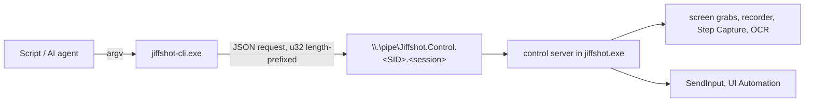

# jiffshot-cli: driving Jiffshot from scripts and AI agents

`jiffshot-cli.exe` ships beside `jiffshot.exe` (`C:\Program Files\Devolutions\Jiffshot`).
It lets a script or an AI agent screenshot, record and narrate a demo of any desktop
software, driving the mouse and keyboard itself, so nobody has to click through the
demo by hand while recording.

Run `jiffshot-cli help` for the full command list and `jiffshot-cli help agent` for
the guide written for AI agents (also printed below in spirit).

## How it works



- The running Jiffshot (the tray process) owns all state: recordings, guides, settings.
  Its control server (`crates/jiffshot-workflow/src/control.rs`) serves a named pipe
  that only the same user can open (a protected DACL with that user's SID; remote
  clients are rejected), named per user and Windows session.
- `jiffshot-cli` is a short-lived client. Each invocation sends one request and prints
  one JSON object. When Jiffshot is not running it starts the `jiffshot.exe` beside it
  (or `JIFFSHOT_EXE`) in the tray and waits until it answers; `--no-launch` disables
  that.
- The protocol lives in `crates/jiffshot-control`: requests are
  `{"protocol":1,"id","command","args"}`, responses `{"id","ok","result"|"error"}`.
  A protocol mismatch is refused with `unsupported`.

## Output and exit codes

stdout carries exactly one JSON object per invocation:

```json
{"ok":true,"result":{"path":"C:\\demo\\shot.png","width":1920,"height":1200,"...":"..."}}
{"ok":false,"error":{"code":"not_found","message":"no window matches title \"Settings\""}}
```

stderr only carries diagnostics. Paths in results are absolute; media is never
inlined.

| Exit | Error codes | Meaning |
|---|---|---|
| 0 | | success |
| 1 | `not_found`, `conflict`, `internal` | the command failed |
| 2 | `invalid_request` | bad usage or arguments |
| 3 | `unavailable`, `unsupported`, `transport` | Jiffshot is not reachable (or too old for the command) |
| 4 | `timeout` | a wait or the reply timed out |

## Commands

| Command | What it does |
|---|---|
| `status` | Version, protocol, library folder, running recording and guide, all commands |
| `monitors` | Displays with rectangles, work areas and DPI |
| `windows [TITLE] [--process P] [--class C] [--all]` | Top-level windows: hwnd, title, process, rect |
| `cursor` | The pointer position |
| `screenshot [TARGET] [--out F.png] [--cursor] [--delay-ms N]` | Capture to PNG (default: into the library) |
| `record start [TARGET] [--out F.mp4] [--fps N] [--audio none\|system\|mic\|both] [--clicks] [--highlight] [--no-cursor] [--max-seconds N] [--key ID]` | Start recording; returns once frames flow |
| `record status \| pause \| resume` | The recording |
| `record stop` / `record cancel` | Finalize the MP4 and return its metadata / delete it |
| `steps start [TITLE] [--restart]` | Begin a step-by-step guide |
| `steps add [X,Y] [--description T] [--right]` | Add a step without clicking |
| `steps status \| cancel` | The guide |
| `steps finish [--out F.png] [--title T] [--open]` | Lay out the guide; saves the PNG and an editable `.jsd` |
| `click [X,Y] [POINTER] [--right\|--middle] [--double] [--no-step] [--description T]` | Click; adds a guide step while a guide is in progress |
| `move [X,Y] [POINTER]` | Move the pointer |
| `drag X1,Y1 X2,Y2` | Drag |
| `scroll N [POINTER] [--horizontal]` | Mouse wheel notches; positive is up (or right) |
| `type TEXT [TARGET] [--delay-ms N]` | Type Unicode text; `\n` is Enter, `\t` is Tab |
| `key COMBO [TARGET] [--repeat N]` | Key combinations: `ctrl+s`, `alt+f4`, `win+r`, `enter`, `f5`… |
| `focus [TITLE] [--process P]` | Restore and bring a window to the front |
| `ocr [TARGET] [--find TEXT]` | Recognized text lines with screen rectangles |
| `elements [TARGET] [--name N] [--type T] [--max N]` | UI Automation controls of a window |
| `wait window [TITLE] [--gone] [--timeout-ms N]` | Wait for a window to appear (or go) |
| `wait text TEXT [TARGET] [--gone] [--timeout-ms N]` | Wait for text on screen (OCR) |
| `open [PATH]` | Open a capture in the editor, or show the editor |
| `quit` | Exit Jiffshot |
| `sleep MS` | Pause (client side) |
| `run FILE.json` | Run a scripted sequence |
| `call COMMAND [JSON]` | Send any command with a raw JSON arguments object |

**TARGET** picks what to capture, look at or type into (default: the monitor under the
pointer): `--screen N`, `--desktop`, `--region X,Y,W,H`, or a window by `--window HWND`
(decimal or `0x` hex), `--title`, `--process` or `--class`. Targeted windows are
restored and brought to the front first unless `--no-activate`.

**POINTER** picks where to act: `X,Y` in screen pixels, `--text TEXT` (found by OCR in
the target), or `--element NAME [--type T]` (UI Automation, in the target window), with
`--nth N` to choose among matches and `--offset DX,DY` to nudge.

Options are `--kebab-case` and become the command's `snake_case` arguments; `--args
'{"glide_ms":0}'` merges extra raw arguments. Global options: `--pretty`,
`--timeout SECS`, `--no-launch`.

## Recording a demo

```powershell
jiffshot-cli windows --process notepad          # pick the hwnd of the right window
jiffshot-cli record start --window 0x86070A --out C:\demo\demo.mp4 --clicks --key demo-1
jiffshot-cli type "Hello from an agent\n" --window 0x86070A
jiffshot-cli click --window 0x86070A --element File
jiffshot-cli wait text "Save as" --window 0x86070A --timeout-ms 5000
jiffshot-cli key esc
jiffshot-cli record stop                        # returns path, size, duration, frames
```

- `record start` returns once frames are flowing, so what follows is on video.
  `record stop` returns after the MP4 is finalized.
- `--key` makes the start idempotent: retrying after a lost reply returns the running
  recording (`"already_started": true`) instead of a conflict.
- While recording, pointer moves glide (`--glide-ms`, default 400) and typing is paced
  (`--delay-ms`, default 35) so viewers can follow. Pass 0 to disable.
- A window target records the window's rectangle at start; keep the window still.

## Step-by-step guides

```powershell
jiffshot-cli steps start "How to save a file"
jiffshot-cli click --title Notepad --element File --description "Open the File menu"
jiffshot-cli click --title Notepad --element "Save as"
jiffshot-cli steps finish --out C:\demo\guide.png
```

Each click during a guide captures the display just before the click, marks it and
captions it (from `--description`, or the UI Automation name of the control). The
guide is saved as a PNG plus an editable `.jsd` beside it.

## Scripted sequences

`jiffshot-cli run demo.json` runs steps in order, stops at the first failure (unless
`continue_on_error`), then always runs `finally`:

```json
{
  "continue_on_error": false,
  "steps": [
    {"command": "focus", "args": {"process": "notepad"}},
    {"command": "record.start", "args": {"process": "notepad", "out": "C:\\demo\\a.mp4"}},
    {"argv": ["type", "Hello\n"]},
    {"sleep_ms": 500},
    {"argv": ["wait", "text", "Hello", "--process", "notepad"], "continue_on_error": true}
  ],
  "finally": [
    {"command": "record.stop"}
  ]
}
```

A step is a `command` (the dotted name `status` lists) with `args`, an `argv` array
(the words you would type after `jiffshot-cli`), or `sleep_ms`. The result reports
every step with its result or error and elapsed time; the exit code is that of the
first failure.

## Tips for agents

- Look before acting (`windows`, `screenshot` then view the PNG, `ocr`, `elements`),
  act on elements or text rather than guessed coordinates, synchronize with
  `wait window`/`wait text` instead of sleeps, and verify afterwards.
- Target exact windows with `--window HWND`: many apps (Notepad, browsers, Office) open
  new documents as tabs in an existing window, which may be one the user is working in.
- Only one recording and one guide run at a time.
- Typed text is sent as Unicode, independent of the keyboard layout.
- Input goes to the interactive desktop: the user should not use the mouse and keyboard
  while a sequence runs.
