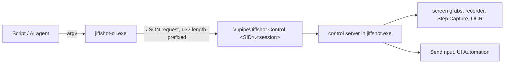

# jiffshot-cli: driving Jiffshot from scripts and AI agents

`jiffshot-cli.exe` ships beside `jiffshot.exe` (`C:\Program Files\Devolutions\Jiffshot`).
It lets a script or an AI agent screenshot, record and narrate a demo of any desktop
software, driving the mouse and keyboard itself, so nobody has to click through the
demo by hand while recording.

Run `jiffshot-cli help` for the full command list and `jiffshot-cli help agent` for
the guide written for AI agents (also printed below in spirit).

## How it works



- The running Jiffshot (the tray process) owns all state: recordings, guides, settings.
  Its control server (`crates/jiffshot-workflow/src/control.rs`) serves a named pipe
  that only the same user can open (a protected DACL with that user's SID; remote
  clients are rejected), named per user and Windows session.
- `jiffshot-cli` is a short-lived client. Each invocation sends one request and prints
  one JSON object. When Jiffshot is not running it starts the `jiffshot.exe` beside it
  (or `JIFFSHOT_EXE`) in the tray and waits until it answers; `--no-launch` disables
  that.
- The protocol lives in `crates/jiffshot-control`: requests are
  `{"protocol":1,"id","command","args"}`, responses `{"id","ok","result"|"error"}`.
  A protocol mismatch is refused with `unsupported`.

## Output and exit codes

stdout carries exactly one JSON object per invocation:

```json
{"ok":true,"result":{"path":"C:\\demo\\shot.png","width":1920,"height":1200,"...":"..."}}
{"ok":false,"error":{"code":"not_found","message":"no window matches title \"Settings\""}}
```

stderr only carries diagnostics. Paths in results are absolute; media is never
inlined.

| Exit | Error codes | Meaning |
|---|---|---|
| 0 | | success |
| 1 | `not_found`, `conflict`, `internal` | the command failed |
| 2 | `invalid_request` | bad usage or arguments |
| 3 | `unavailable`, `unsupported`, `transport` | Jiffshot is not reachable (or too old for the command) |
| 4 | `timeout` | a wait or the reply timed out |

## Commands

| Command | What it does |
|---|---|
| `status` | Version, protocol, library folder, running recording and guide, all commands |
| `monitors` | Displays with rectangles, work areas and DPI |
| `windows [TITLE] [--process P] [--class C] [--all]` | Top-level windows: hwnd, title, process, rect |
| `cursor` | The pointer position |
| `screenshot [TARGET] [--out F.png] [--cursor] [--delay-ms N]` | Capture to PNG (default: into the library) |
| `capture scroll [TARGET] [--out F.png] [--horizontal] [--max-frames N] [--timeout-ms N] [--settle-ms N] [--notches N]` | Automatically scroll and stitch a content region, with time/frame/pixel limits |
| `record start [TARGET] [--out F.mp4] [--fps N] [--audio none\|system\|mic\|both] [--clicks] [--highlight] [--no-cursor] [--max-seconds N] [--key ID]` | Start recording; returns once frames flow |
| `record status \| pause \| resume` | The recording |
| `record options [--id ID] [--args JSON]` | Change live camera, audio, cursor, highlight and click switches |
| `record annotate --kind JSON [--style JSON] [--duration-ms N]` | Render an annotation into recorded frames, without desktop input |
| `record clear [--id ID]` | Remove live recording annotations |
| `record stop` / `record cancel` | Finalize the MP4 and return its metadata / delete it |
| `steps start [TITLE] [--restart]` | Begin a step-by-step guide |
| `steps add [X,Y] [--description T] [--right]` | Add a step without clicking |
| `steps status \| cancel` | The guide |
| `steps finish [--out F.png] [--title T] [--open]` | Lay out the guide; saves the PNG and an editable `.jsd` |
| `click [X,Y] [POINTER] [--right\|--middle] [--double] [--no-step] [--description T]` | Click; adds a guide step while a guide is in progress |
| `move [X,Y] [POINTER]` | Move the pointer |
| `drag X1,Y1 X2,Y2` | Drag |
| `scroll N [POINTER] [--horizontal]` | Mouse wheel notches; positive is up (or right) |
| `type TEXT [TARGET] [--delay-ms N]` | Type Unicode text; `\n` is Enter, `\t` is Tab |
| `key COMBO [TARGET] [--repeat N]` | Key combinations: `ctrl+s`, `alt+f4`, `win+r`, `enter`, `f5`… |
| `focus [TITLE] [--process P]` | Restore and bring a window to the front |
| `ocr [TARGET] [--find TEXT]` | Recognized text lines with screen rectangles |
| `elements [TARGET] [--name N] [--type T] [--max N]` | UI Automation controls of a window |
| `wait window [TITLE] [--gone] [--timeout-ms N]` | Wait for a window to appear (or go) |
| `wait text TEXT [TARGET] [--gone] [--timeout-ms N]` | Wait for text on screen (OCR) |
| `open [PATH]` | Open a capture in the editor, or show the editor |
| `quit` | Exit Jiffshot |
| `sleep MS` | Pause (client side) |
| `run FILE.json` | Run a scripted sequence |
| `call COMMAND [JSON]` | Send any command with a raw JSON arguments object |
| `doc tools \| list` | Discover annotation tools, variants, default styles, effects, templates, themes and formats; list open document sessions |
| `doc new --width W --height H [--color C]` / `doc open PATH` | Create/load an editable document and return its stable `id` |
| `doc status --id ID` | Dimensions, objects, selection, modified state and undo/redo labels |
| `doc draw --id ID --tool T --from X,Y --to X,Y [--variant V] [--text T] [--style JSON] [--points JSON] [--amount N]` | Use any editor annotation/raster tool in document coordinates |
| `doc add --id ID --kind JSON [--style JSON]` | Add precise typed geometry, including curved arrows and multi-tail callouts |
| `doc update --id ID --object-id N [--kind JSON] [--style JSON] [--rotation N]` | Edit an existing object's geometry and appearance |
| `doc image PATH --id ID [--at X,Y]` | Insert image pixels |
| `doc select --id ID --object-ids JSON` / `doc action NAME --id ID` | Select, undo/redo, group, align, move, delete, duplicate, stack, rotate or flip |
| `doc crop --id ID --x X --y Y --width W --height H` | Crop with strict canvas bounds |
| `doc resize --id ID --width W --height H [--canvas] [--x X --y Y] [--color C]` | Resample image/objects, or expand/reposition the canvas |
| `doc effect NAME --id ID [--color C --fill C]` | Apply an existing named effect with its catalog defaults |
| `doc ocr \| redact \| simplify --id ID` | Recognize bitmap text; add sensitive-pattern redactions; simplify UI text/colors |
| `doc combine --document-ids JSON [--layout vertical\|horizontal\|grid] [--gap N] [--template NAME] [--theme NAME] [--captions] [--numbers] [--footer T]` | Build an editable montage or template from document images |
| `doc save --id ID --out F.jsd` / `doc export --id ID --out FILE` | Save editable source / flattened PNG, JPEG, BMP, GIF, WebP or PDF |
| `doc close --id ID` | Release the headless document session |
| `video info PATH` | Inspect video dimensions, fps, duration and audio |
| `video frame PATH --at SECONDS --out F.png` | Extract a decoded frame |
| `video export PATH --out F.mp4\|gif [--from S --to S] [--fps N] [--width W --height H] [--mute] [--overlays JSON]` | Trim, resample, resize and overlay; wait for final export |
| `video join --segments JSON --out F.mp4 [--fps N] [--width W --height H] [--mute] [--overlays JSON]` | Join trimmed segments and add timed images/editable annotations |

**TARGET** picks what to capture, look at or type into (default: the monitor under the
pointer): `--screen N`, `--desktop`, `--region X,Y,W,H`, or a window by `--window HWND`
(decimal or `0x` hex), `--title`, `--process` or `--class`. Targeted windows are
restored and brought to the front first unless `--no-activate`.

**POINTER** picks where to act: `X,Y` in screen pixels, `--text TEXT` (found by OCR in
the target), or `--element NAME [--type T]` (UI Automation, in the target window), with
`--nth N` to choose among matches and `--offset DX,DY` to nudge.

Options are `--kebab-case` and become the command's `snake_case` arguments; `--args
'{"glide_ms":0}'` merges extra raw arguments. Global options: `--pretty`,
`--timeout SECS`, `--no-launch`.

## Recording a demo

```powershell
jiffshot-cli windows --process notepad          # pick the hwnd of the right window
jiffshot-cli record start --window 0x86070A --out C:\demo\demo.mp4 --clicks --key demo-1
jiffshot-cli type "Hello from an agent\n" --window 0x86070A
jiffshot-cli click --window 0x86070A --element File
jiffshot-cli wait text "Save as" --window 0x86070A --timeout-ms 5000
jiffshot-cli key esc
jiffshot-cli record stop                        # returns path, size, duration, frames
```

- `record start` returns once frames are flowing, so what follows is on video.
  `record stop` returns after the MP4 is finalized.
- `--key` makes the start idempotent: retrying after a lost reply returns the running
  recording (`"already_started": true`) instead of a conflict.
- While recording, pointer moves glide (`--glide-ms`, default 400) and typing is paced
  (`--delay-ms`, default 35) so viewers can follow. Pass 0 to disable.
- A window target records the window's rectangle at start; keep the window still.
- `--audio mic` is an alias for `microphone`. Camera options at start are
  `--webcam`, `--webcam-corner top-left|top-right|bottom-left|bottom-right`,
  `--webcam-circle`, `--webcam-size 0.25` (fraction of recording width,
  0.05..0.75), and microphone `--noise-gate`.
- Runtime switches are `cursor`, `highlight`, `clicks`, `webcam`,
  `webcam_circle`, `webcam_corner`, `system` and `microphone`. For example:
  `record options --args '{"microphone":false,"webcam":true}'`.
  Check the returned `options` and `audio_note`: an unavailable camera or audio
  device reports a note and turns off its switch. `record status` and `record stop`
  also return `system_silent` and `microphone_silent`, indicating whether a source
  has recently produced no detectable sound; the indicators clear when sound
  resumes or recording is paused.
- The recorder is exclusive across tray and CLI launches. A tray-started recording
  is reported as `tray_recording` but must be finalized from its toolbar; the CLI
  never silently takes it over. Concurrent CLI starts/stops are serialized.
- Recording outputs must not already exist. `--max-seconds` is a positive finite
  wall-clock limit (up to 86400), including pauses, not recorded duration.

## Live annotations

Annotations are composited into the video, not clicked/drawn onto the user's
desktop. They use **recording-local pixels**: subtract the target rectangle's
screen origin from absolute desktop coordinates.

```powershell
jiffshot-cli record annotate --kind '{"type":"Line","a":{"x":20,"y":30},"b":{"x":180,"y":90}}' --style '{"stroke":"#FF0000","end_cap":"Arrow","width":8}' --duration-ms 3000
jiffshot-cli record annotate --kind '{"type":"Text","rect":{"x0":20,"y0":100,"x1":400,"y1":180},"text":"Open Settings"}' --style '{"text_color":"#FFFFFF","fill":"#C0000000","font_size":32}'
jiffshot-cli record clear
```

`duration_ms=0` persists until cleared/stopped. Positive durations use recorded
time, so pausing does not consume them. Up to 256 live marks are retained.
Supported geometry uses the same `Kind` schema as `doc add`: Line, Shape, Text,
Callout, Step, Pen, Highlight, Blur, Magnify, Polygon, Spotlight and Stamp.
For image overlays, use video post-production below.

## Editable annotations and image editing

Headless document sessions use the same Rust `Editor` and `Document` engine as the
desktop editor, including undo/redo. They are deliberately **separate from GUI
documents**, so an agent cannot accidentally overwrite the user's unsaved editor
work. Save a `.jsd` and use `open PATH` to inspect it in the GUI when desired.

```powershell
$d = (jiffshot-cli doc open C:\demo\shot.png | ConvertFrom-Json).result.id
jiffshot-cli doc draw --id $d --tool Arrow --from 30,40 --to 240,100
jiffshot-cli doc draw --id $d --tool Callout --from 30,130 --to 400,230 --text "Choose this option"
jiffshot-cli doc draw --id $d --tool Blur --variant Redact --from 20,260 --to 300,310
jiffshot-cli doc effect "Rounded corners" --id $d
jiffshot-cli doc save --id $d --out C:\demo\annotated.jsd
jiffshot-cli doc export --id $d --out C:\demo\annotated.png
jiffshot-cli doc close --id $d
```

- Colors are `#RGB`, `#RRGGBB` or **`#AARRGGBB`**, not RGBA byte order.
  `doc tools` returns exact tool names/variants, the full default `Style` object,
  effect names, templates, themes and export formats. Unknown style properties
  fail instead of being ignored. Style patches retain unspecified defaults.
- `doc draw` always creates a new annotation even when geometry overlaps another.
  For paths, `--points '[{"x":10,"y":20},{"x":30,"y":50},{"x":70,"y":10}]'`
  supplies vertices/stroke samples. Shift/Ctrl/Alt modifiers follow the editor.
  Raster tools include fill, crop, cut out, selection/lifting, magic wand, eraser,
  eyedropper, Smart Move and OCR-backed Text Replace.
- Precise `doc add`/`doc update` geometry is the serialized `jiffshot-doc::object::Kind`
  tagged union. Rectangles use `{x0,y0,x1,y1}`, points `{x,y}`. Line/arrow kinds
  optionally take `control` for a curved arrow. An `Image` needs actual pixels,
  so insert it through `doc image`, not an unresolved JSON image reference.
- `doc action` supports `undo`, `redo`, `select-all`, `invert-selection`, `delete`,
  `duplicate`, `group`, `ungroup`, `flatten`, `move` (x/y offsets), `text`,
  `front`, `back`, `forward`, `backward`, `rotate-right`, `rotate-left`,
  `flip-horizontal`, `flip-vertical` and `align-left/right/top/bottom/center/middle`.
- For comparisons/step layouts, open the source images, then `doc combine` with
  their ids. Use `--template "Before and after"` or `"Step by step"` and a theme.
  Captions/title/footer remain editable objects returned by `doc status`.
- Eight document sessions are retained; explicitly close them in script cleanup.
  Canvas limits are 16384 per side and 64 million pixels, with 4096 top-level
  objects, 10000 path samples and the editor's bounded 100-step undo history.
  Sessions are in-memory and disappear when Jiffshot quits; `.jsd` saves persist.

**Privacy:** blur/pixelation are presentation effects, not guaranteed secrecy.
Use opaque redaction and export a flattened image for distribution. Editable `.jsd`
files intentionally retain the original background, including covered information.
Automatic sensitive-pattern detection depends on OCR and does not find every secret;
inspect its results before sharing.

## Video post-production

The CLI and desktop video editor share the Media Foundation post-production
engine. Commands operate on files and do not scrub or replace the user's GUI
session. Outputs are finalized before success and staged atomically; an error
keeps an existing destination intact. Outputs cannot overwrite their input sources.

```powershell
jiffshot-cli video info C:\demo\raw.mp4
jiffshot-cli video export C:\demo\raw.mp4 --from 2 --to 12 --fps 30 --width 1280 --height 720 --out C:\demo\trimmed.mp4
jiffshot-cli video frame C:\demo\trimmed.mp4 --at 3 --out C:\demo\cover.png
jiffshot-cli video join --segments '[{"path":"C:\\demo\\take1.mp4","from":1,"to":8},{"path":"C:\\demo\\take2.mp4","from":0,"to":6}]' --out C:\demo\joined.mp4
jiffshot-cli video export C:\demo\joined.mp4 --fps 10 --out C:\demo\preview.gif
```

Times are seconds. MP4 exports support 1..120 fps; GIF supports 1..50 fps and
defaults to 10 fps / maximum width 960. GIF options can be supplied through
`--args '{"max_width":800,"loop":true,"fade":false,"dither":true}'`.
Joining re-encodes and fits source frames into the output geometry, rather than
requiring identical source resolutions. Join outputs MP4; export that MP4 to GIF
as a separate step if needed. MP4 audio is preserved when all segments share a
supported 44.1/48 kHz mono/stereo format. Mismatched, unsupported or undecodable
audio is an error unless `--mute` explicitly permits dropping it; GUI exports
retain their previous compatibility policy. GIF has no soundtrack and returns an
`audio_note` when discarding source audio. Inspect finalized metadata (`path`, `format`, `width`,
`height`, `fps`, `duration`, `audio`, `bytes`, `frames`).

For titles, watermarks, captions, arrows or privacy masks on an existing video,
create a **transparent** annotation document (`doc new --color "#00000000"`),
save it, then add timed overlays:

```powershell
jiffshot-cli video export C:\demo\raw.mp4 --out C:\demo\captioned.mp4 --overlays '[{"path":"C:\\demo\\caption.jsd","x":20,"y":20,"from":0,"to":5}]'
```

Overlays load ordinary images or `.jsd`, and are composited at output-pixel x/y
positions. Their intervals are half-open (`from <= time < to`) on the **output**
timeline after trimming/joining; use transparent backgrounds unless intentionally
covering the scene. Up to 256 segments/overlays are accepted.

## Step-by-step guides

```powershell
jiffshot-cli steps start "How to save a file"
jiffshot-cli click --title Notepad --element File --description "Open the File menu"
jiffshot-cli click --title Notepad --element "Save as"
jiffshot-cli steps finish --out C:\demo\guide.png
```

Each click during a guide captures the display just before the click, marks it and
captions it (from `--description`, or the UI Automation name of the control). The
guide is saved as a PNG plus an editable `.jsd` beside it.

## Scripted sequences

`jiffshot-cli run demo.json` runs steps in order, stops at the first failure (unless
`continue_on_error`), then always runs `finally`:

```json
{
  "continue_on_error": false,
  "steps": [
    {"command": "focus", "args": {"process": "notepad"}},
    {"command": "record.start", "args": {"process": "notepad", "out": "C:\\demo\\a.mp4"}},
    {"argv": ["type", "Hello\n"]},
    {"sleep_ms": 500},
    {"argv": ["wait", "text", "Hello", "--process", "notepad"], "continue_on_error": true}
  ],
  "finally": [
    {"command": "record.stop"}
  ]
}
```

A step is a `command` (the dotted name `status` lists) with `args`, an `argv` array
(the words you would type after `jiffshot-cli`), or `sleep_ms`. The result reports
every step with its result or error and elapsed time; the exit code is that of the
first failure.

Scripts may declare `"version":1`. Successful steps can save their result under
`save_as`; subsequent arguments and cleanup use exact `{"$ref":"name.field"}` objects.
References preserve the JSON type, support numeric array indices, and fail loudly
on missing results/fields. No shell commands or code interpolation are performed.
Relative input/output paths (including segment/overlay paths) resolve against the
CLI's working directory.

```json
{
  "version": 1,
  "steps": [
    {"command": "doc.new", "args": {"width": 640, "height": 360}, "save_as": "image"},
    {"command": "doc.draw", "args": {"id": {"$ref": "image.id"}, "tool": "Text", "from": "20,20", "to": "620,120", "text": "Demo title"}},
    {"command": "doc.save", "args": {"id": {"$ref": "image.id"}, "out": "title.jsd"}},
    {"command": "doc.export", "args": {"id": {"$ref": "image.id"}, "out": "title.png"}}
  ],
  "finally": [
    {"command": "doc.close", "args": {"id": {"$ref": "image.id"}}}
  ]
}
```

## Capability review and boundaries

The original CLI had no annotation, image-editing or video-editing commands.
The expanded surface covers ordinary automated product demos end-to-end, not
every possible desktop or professional video workflow:

| Agent need | CLI coverage / boundary |
|---|---|
| Observe and operate software | Window handles, screenshots, OCR, UI Automation elements, focus, mouse/keyboard and bounded waits. Acceptance is not proof the app processed an action; verify afterwards. |
| Record a demo | Display/window/region/desktop targets, fps, pause/resume, finalized MP4, system/mic audio, camera, cursor emphasis, click rings and runtime switches. A target window is a fixed rectangle, not a moving-window tracker. |
| Annotate during a recording | Live timed text, arrows, shapes, highlights, redaction, steps, spotlight and magnification, composited without stealing input. Blur/magnification sample each current recording frame rather than a cached screenshot. |
| Annotate screenshots / edit guides | All vector tools, editable geometry/styles, raster tools, Smart Move/Text Replace, sensitive-pattern redaction, simplify, crop/resize/rotate/flip, grouping/stacking/alignment, effects, combining/templates and image/PDF exports. |
| Finish video / animated demos | Inspect, frame extraction, trim, resize/fps conversion, join, mute, timed image/document overlays, MP4/GIF exports. |
| Repeatable automation | JSON results, typed errors, ids, idempotent recording start, scripted sequencing, typed saved-result references and guaranteed cleanup execution after step failures. Scripts still run in the client, not a durable server-side job ledger. |
| Scrolling captures | Bounded vertical/horizontal scroll-and-stitch. `limited`/`stopped` reports frame/pixel/deadline truncation. Prefer content-only regions without sticky headers; a failed overlap reports an error. The cursor is restored, but the page scroll position is not. |
| Other special capture modes | Open menus can be captured with a target rectangle and delayed screenshot; freehand/multi-area compositions can be masked/combined in documents. Native interactive panoramic/two-axis capture, daily scheduling and presets are not dedicated CLI APIs. |
| Professional video timeline | No multitrack timeline, transitions, speed ramps, synthesized narration, subtitles/transcription, background-music mixing, camera-device selection or arbitrary codecs. Use an external media tool for these rather than assume support. |
| GUI editor/settings/sharing | Headless documents/video file editing do not expose the user's live GUI document, preferences, saved styles/presets or mail/Office/FTP/print dialogs. `open` is available for visual inspection. |
| Platform/security | Windows and macOS interactive user desktop only (see [macOS notes](#macos-notes)). No Session-0 capture, lock-screen/UAC secure-desktop bypass or automation of protected/elevated apps beyond Windows permissions. Same-user programs are inside the control pipe's trust boundary. |
| Safe unattended work | Target exact HWNDs and dedicated demo apps; don't type into the user's existing documents. Device warnings, OCR uncertainty and annotations must be inspected. A disconnected client does not roll back an already accepted command. |

This matrix is the coverage contract: unsupported rows are intentional boundaries,
not promises hidden behind a success response.

## macOS notes

- `jiffshot-cli` is in `Jiffshot.app/Contents/MacOS` and talks to the running app over a
  private per-user Unix socket in the app's local-data directory; both ends verify the
  peer user.
- Window ids are Quartz window numbers rather than HWNDs; `--class` matches the
  owning application name.
- Untargeted screenshots, scrolling captures and recordings use the primary display;
  OCR and text search without a target use the whole desktop.
- Positive vertical `scroll` notches scroll down, the opposite of Windows;
  positive horizontal notches scroll right.
- `elements` and `--element` use the Accessibility API, and input uses Quartz events.
  Jiffshot needs Screen Recording and Accessibility permissions (and Microphone/Camera
  for those recording sources); missing permissions are reported as errors.
- Direct Office insertion is not available; use files, the clipboard or `open`.

## Tips for agents

- Look before acting (`windows`, `screenshot` then view the PNG, `ocr`, `elements`),
  act on elements or text rather than guessed coordinates, synchronize with
  `wait window`/`wait text` instead of sleeps, and verify afterwards.
- Target exact windows with `--window HWND`: many apps (Notepad, browsers, Office) open
  new documents as tabs in an existing window, which may be one the user is working in.
- Only one recording and one guide run at a time.
- Typed text is sent as Unicode, independent of the keyboard layout.
- Input goes to the interactive desktop: the user should not use the mouse and keyboard
  while a sequence runs.
